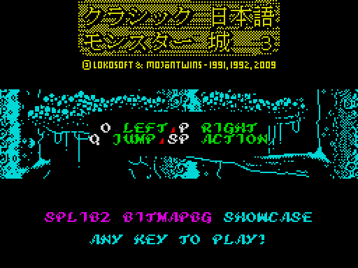
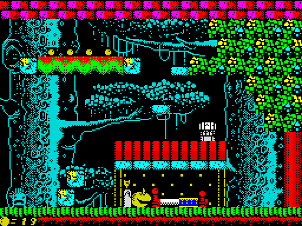
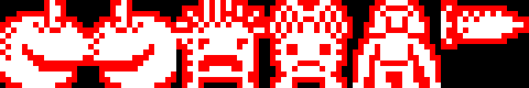
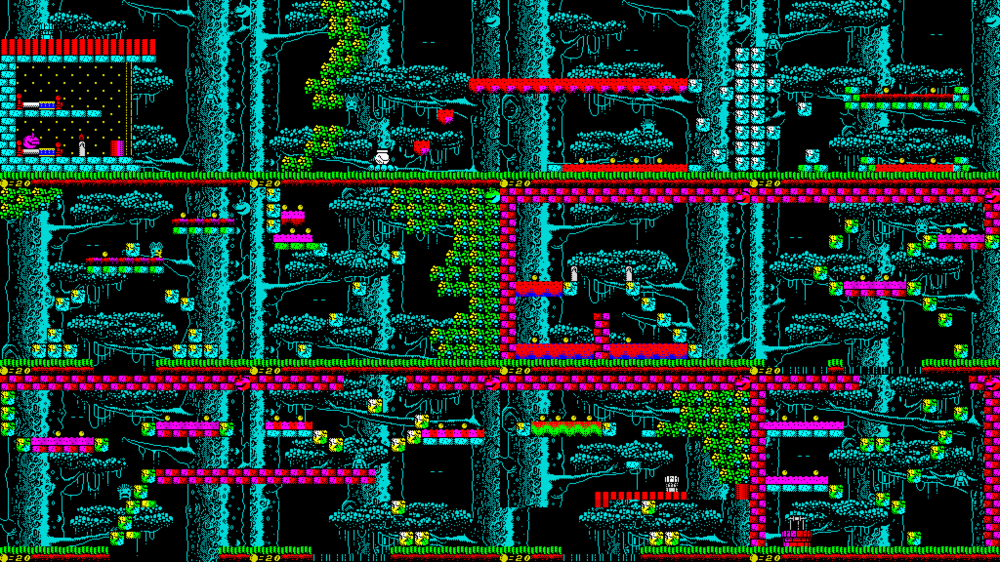

# Kurashiku Nihongo Monsuta Shiro 3 — C port (z88dk + splib2-bitmapbg)

This is a port of *CJMC3*, the Mojon Twins' 2009 HiSoft BASIC + fourSpriter
remake of a LOKOsoft game, to **C + inline asm for z88dk (classic, sccz80)**
with the splib2 in this repository:

* **Pixel-by-pixel masked sprites at 25 fps**: the player, the enemy and the
  boniato you carry.
* **The woods in cyan instead of dark blue.** Sprites take the colour of the
  cell they are on, so the original INK 1 made them almost invisible.
* **No drawing on the real screen.** Each screen is three ZX0-packed screen
  thirds, depacked straight into the shadow screen, plus a tile layout
  painted into the shadow with `sp_BgPutTile`. Everything that doesn't move
  in the original (platforms, trees, houses, the HUD, boniato patches, fires,
  blinking eyes) is an ordinary 8×8 tile.

 

The whole game is here: 12 screens, planting, watering and harvesting
boniatos, the well, Grand Bolote's cauldron, the wandering enemy, water,
lives, the title screen with its scrolling logo, game over and the ending.

Controls: **O** left, **P** right, **Q** jump, **SPACE** action.

---

## 1. Building

```
./build.sh          # Linux / macOS
make.bat            # Windows
```

You need z88dk classic (see [`../../docs/TOOLCHAIN.md`](../../docs/TOOLCHAIN.md)),
Python 3 (standard library only) and `../../splib2f.lib` built with
`BITMAPBG = 1` (run `../../build.sh` first). The result is `cjmc3.tap`.

The [zx0](https://github.com/einar-saukas/ZX0) compressor is only needed
when a picture or a screen layout changes. The packed files are kept in
`gfx/` (thirds) and `gfx/layouts/` (layouts), and `build.sh` repacks a
third when its `.bin` is newer than its `.zx0`. Set `ZX0=/path/to/zx0` if
it isn't in the `PATH`.

## 2. Changing the sprites

Edit **`gfx/sprites.png`** with any image editor and rebuild. Nothing else
is needed.



* 96×16 pixels: six 16×16 frames side by side, in this order:
  player facing right, player facing left, enemy 1, enemy 2, enemy 3, and
  the boniato carried over the player's head (top 8 lines only).
* **White** (any light colour) is ink. **Black** (or transparent) is
  see-through. **Red** is solid paper: the mask, i.e. where the background
  is erased behind the sprite.
* A frame with **no red at all** gets an automatic mask: the inside of the
  figure (everything the outside can't reach) plus a 1 px halo around the
  ink. The sheet as shipped has that automatic mask painted in red, so you
  can see it and change it.
* Any PNG works: RGB, RGBA, indexed or greyscale, any bit depth, as long as
  it isn't interlaced. If you delete the file, the next build recreates it
  from the original UDGs (`gfx/udg.bin`).

`tools/conv.py` checks the size and stops with a message if it's wrong.
To add frames, add them to the PNG and to `SPR_NAMES` in `tools/conv.py`,
and use the new frame numbers in `src/cjmc3.c` (`SPR_*` in `assets.h`).

## 3. How it uses splib2-bitmapbg

The library side is documented in [`../../docs/BITMAPBG.md`](../../docs/BITMAPBG.md)
(§5.2 covers the helpers used here).

| Need | How |
|---|---|
| New screen | `sp_ZX0(third, sp_BgThird(i))` for the three thirds, `sp_BgAttrFill(5)` (cyan, and every cell dirty), then the screen's layout is depacked into `layout_buf` and painted tile by tile with `sp_BgPutTile`. One `sp_UpdateNow()` shows it with the sprites on top. The real screen is never drawn on, so there is no capture and the sprites never disappear. |
| Collision map | In the display list's tile byte (`dlist[cell*4+1]`), which BITMAPBG doesn't use. It is set while the layout is painted, from the **original** attributes: BRIGHT = solid (1), plain INK 5 = water (2), as the BASIC code tested with `ATTR`. `box_free()` (asm) tests a 16×16 box against it. |
| HUD (rows 22–23) | The layout's own rows 22–23 are repainted (`t_minrow = 22`), then lives, water, carried boniatos and score are put on top as tiles. Called only when something changes. |
| Animated tiles | Fires (4 frames) and blinking eyes are `sp_BgPutTile` calls once per tick (4 frames). The patches change tile as boniatos grow. splib2 recomposes any sprite standing there. |
| Title logo scroll | The logo is depacked into the bottom third of the shadow and scrolled up 17 rows inside the shadow (`row_copy`), with `sp_BgShow()` after each step. There are no sprites on the title screen. |
| Ending typewriter | One `sp_BgPutTile` + `sp_UpdateNow()` per letter. |

### Assets (`tools/conv.py` → `src/assets.h`)

* **Thirds and pictures**: the original's six woods thirds, the logo and the
  ending picture, 2048 bytes each in display-file order (`gfx/*.bin`),
  ZX0-packed: 16 KB → 9.5 KB. Which thirds make each screen comes from the
  original's table (`gfx/backdropthirds.bin`).
* **Layouts**: `tools/layout.py` is a small interpreter for the BASIC
  drawing subroutines (`PRINT AT`, `INK`/`PAPER`/`BRIGHT`, zmakebas colour
  escapes, `FOR`/`NEXT`, `LET`, and the `GO SUB 410/420` helpers). It runs
  each screen's lines from `orig/sources.bas` and records every cell
  printed. `conv.py` encodes that as a byte stream:

  ```
  F0 r c       cursor to (r, c)
  F1 a         attribute
  F2 n t       n times tile t
  F3 n t1 t2   n times the pair t1 t2
  FF           end
  other        a tile at the cursor; the cursor advances (wrapping)
  ```

  then ZX0-packs it: 5.8 KB → 2.1 KB. The game depacks the current screen's
  layout into `layout_buf` (704 bytes).
* **Tiles**: 213 tiles of 8×8 = the game font (96), the UDGs (21) and the
  text font (96). The remap is `TILE_GFX` / `TILE_UDG` / `TILE_FONT` in `assets.h`.
* **Sprites**: from `gfx/sprites.png` (§2). Frame layout as in Lhikoj:
  column A (16 lines + 8 blank) and column B (16 + 8), 2 bytes per line
  (graphic, mask), 96 bytes per frame. The third column points at
  `SPNullSprPtr`.
* **Sound**: the original's six 50-byte beeper effects and its footstep are
  position-independent, so they are included as they were and called
  directly. `BORDCR` is set to 0 so they keep the border black.

## 4. Memory map (48K)

```
$5E88-$CD9E  binary (org 24200): code, splib2, assets, display list
   ...-$D62F stack (grows down)
$D62F-$D7FF  splib2 block memory: 31 blocks x 15
$D800-$EFFF  SHADOW: background bitmap, display-file layout
$F000-$F100  IM2 vector table
$F1F1-       splib2 generic ISR
$F200-$FFFF  splib2 horizontal rotation tables
```

Packing the layouts with ZX0 is what makes it fit. Raw, the binary ended
at `$D92D`, inside the block memory.

## 5. Code conventions

* **No local variables**, and as few parameters as possible: functions
  communicate through globals (`t_row`, `t_col`, `t_attr`, `t_tile` for
  painting, `bx`/`by` for collision tests, `s_n`/`s_f`/`s_x`/`s_y` for
  sprites...). Only library calls take parameter lists. The comment at the
  top of the globals in `src/cjmc3.c` lists which function clobbers which
  global.
* sccz80 `__FASTCALL__` parameters live in HL and can only be used from
  inline asm, never by name in C. `inport` and `sfx` use them that way.
* Speeds and timings are constants at the top of `src/cjmc3.c`
  (`PLAYER_HORZ_SPEED`, `ENEMY_SPEED`, `TICK_FRAMES`, `GROW_FRAMES`, ...),
  plus the jump arc `jump_tab`.

## 6. Timing

The ISR hook counts interrupts, `wait_frame()` waits for two, so the game
runs at **25 fps**. In the emulator, idle and walking frames never overrun.
The only frames that take longer are the ones playing a beeper effect (the
original routines block, as on the original).

## 7. Differences from the BASIC version

* **Movement is pixel by pixel**: 2 px per frame horizontally and gravity
  at 2 px per frame. Collisions use a 16×16 box against the cell map. The
  enemy uses the same physics and the original's random AI; one AI step
  ("tick") is 4 frames (8 px), the distance of one original step.
* **Jumps follow an arc** (`jump_tab` in `src/cjmc3.c`): 40 px in total,
  the original's 5 characters, rising at 4 px per frame at first and
  slowing down near the top. The rise is applied before walking in each
  frame, and it is faster than walking. So a jump next to a ledge always
  meets the ledge's side, never its underside, and the slow top leaves time
  to land on a ledge **32 px above your feet** while holding the direction
  from the start. Hitting your head ends the jump. The table can be edited
  freely (`JUMP_STEPS` is its length).
* Positions that the original compared exactly in characters (the well,
  the cauldron, the boniato patches) use the player's nearest character
  `(p+4)>>3`, with ±1 character of slack for the well and the cauldron.
* **Action (SPACE) is edge-triggered**: one action per press. The original
  repeated it while the key was held, so it could plant and water a patch
  in one go.
* The carried boniato is a sprite **above** the player's head. The original
  printed it over the player's top half.
* Carried boniatos are shown in the HUD at columns 22–27. The original drew
  them at columns 1–8, on top of the lives counter.
* "GAME OVER!" uses the text font. The original printed it with the game
  font, which turned it into graphics.
* An enemy never spawns within 32 px of the player.
* **No title music.** The original's music player (`musica.bin`) is
  assembled for a fixed address, with absolute jumps and song pointers, so
  it can't be dropped into this memory map. The sound effects are all
  there.
* The title credit says "SPLIB2 BITMAPBG SHOWCASE" instead of "FOURSPRITER
  SHOWCASE".
* The ending is reached when the score is at least 30. The original
  required exactly 30, which could be overshot by delivering 3 at a time.

## 8. Files

```
build.sh, make.bat     build (convert assets, compile, make the tape)
cjmc3.tap              the game
src/cjmc3.c            the game code
src/assets.h           generated by tools/conv.py
tools/conv.py          asset converter
tools/layout.py        interpreter for the BASIC screen-drawing code
tools/png.py           minimal PNG reader/writer (standard library only)
gfx/sprites.png        the sprite sheet: edit this
gfx/*.bin, *.zx0       thirds, pictures (raw and packed), fonts, UDGs,
                       boniato table, thirds table, sound effects
gfx/layouts/           packed screen layouts (cache, regenerated as needed)
orig/sources.bas       the original HiSoft BASIC source
shots/                 screenshots
```



Credits: original game by LOKOsoft (1991/1992), remake and all assets by
The Mojon Twins (2009). ZX0 by Einar Saukas.
