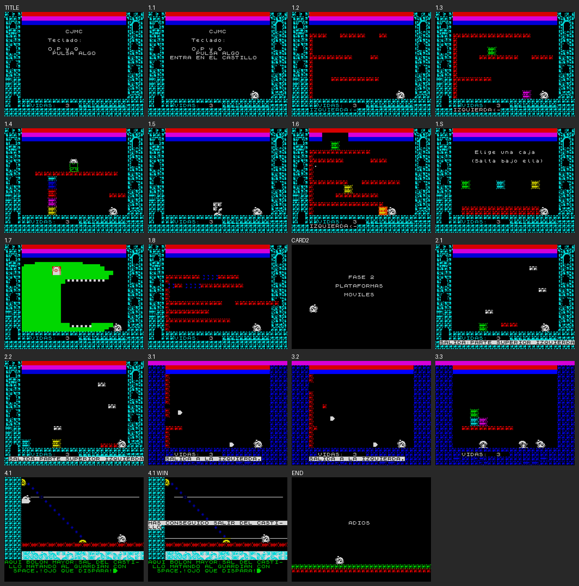

# CJMC93: the game, section by section

This is the reference for talking about the game and changing it. Every
part of it has a name in **bold capitals** or a room number (**1.4**,
**3.1**...). Use those names to ask for changes ("in 2.1, make the
platforms faster", "PHYSICS: lower jump"). The same names appear in the
comments of `src/cjmc93.c`, `gfx/rooms.txt` and `BUGS.md`.

For each section:

* **What happens**: the game as it plays.
* **Original**: the lines of the original program (`orig/cjmc93.bas.txt`).
* **Port**: where it is in `src/cjmc93.c`, and its data.
* **Tune**: the constants and data that change it.



---

## 1. The whole game

*Classic Japanese Monster Castle '93* (LOKO SOFT, 1993) is the first of
two tapes. You enter a castle and go room by room, always leftwards,
through four phases:

| Phase | Rooms | Title card |
|---|---|---|
| 1. The castle | **1.1** to **1.8**, plus the secret **1.S** | (none: the title screen is room 1.1) |
| 2. *Plataformas móviles* (moving platforms) | **2.1**, **2.2** | **CARD2** |
| 3. *Cuevas subterráneas* (underground caves) | **3.1**, **3.2**, **3.3** | **CARD3** |
| 4. *El puente levadizo* (the drawbridge) | **4.1** | **CARD4** |

Then comes **END**. Three lives (**HUD**). Losing one sends you back to
where you came into the room (**DEATH**). Losing the last one sends you
back to the **TITLE** (**GAME OVER**).

The flow is a table in the code (`room_layout`, `room_x`, `room_y`,
`room_exit`, `room_next`, under *Game state*). Each room is played by
`play_room ()`. The cards are `card ()`.

```
TITLE -> 1.1 -> 1.2 -> 1.3 -> 1.4 -> 1.5 -> 1.6 ----------> 1.7 -> 1.8 -> CARD2
                                             \-> 1.S -----/
CARD2 -> 2.1 -> 2.2 -> CARD3 -> 3.1 -> 3.2 -> 3.3 -> CARD4 -> 4.1 -> END -> TITLE
```

---

## 2. The engine (shared by every room)

### ROOM DRAWING

**What happens**: a room is a backdrop with the room's own bricks, boxes,
texts... painted over it.

**Original**: every room had its own `PRINT` lines, after
`RANDOMIZE USR 61913`, which copied the backdrop (tape block 2) to the
screen.

**Port**: `room_draw ()` draws any room. Rooms are in `gfx/rooms.txt`,
made with the room editor (`tools/roomed`), in its compact encoding: a
header (backdrop, picture, texts), then objects (char, rect, figure,
pattern of tiles). `tools/conv.py` turns them into bytes, and `room_objects ()` reads
them.

1. `backdrop_draw ()`, the header's first byte: the backdrop (`gfx/backdrops/castle.png`,
   `cave.png`, `bridge.png`, or black) depacked whole into splib2's
   background buffer (the shadow screen). Paint anything on it, the play
   area included: the sprites restore it as they move.
2. The room's **picture**, the header's second byte (0 none, 1 temple,
   2 castle, 3 corridor; `gfx/pictures/*.png`): decoration for the game area, 192 px wide,
   resting on the bottom frame. It is unpacked straight into the buffer
   by `pic_unpack ()`, a ZX0 decoder that writes the picture's lines where
   they go on the screen (no intermediate buffer). It has no colours of
   its own: the castle's game area is `INK 6` (`PLAY_INK` in
   `tools/conv.py`, also in the cave), so pictures are yellow, and so
   are the sprites there.
3. The room's objects (`room_objects ()`), as 8x8 tiles over the
   backdrop and the picture.
4. The room's texts, the header's third byte: a set of
   `gfx/texts.txt` (`room_texts ()`; rooms can share one, 0 = none).
   One byte per letter instead of an object per letter. Never solid. A
   space on black paper isn't drawn, so the picture shows between words.
5. **1.S** only: the boxes and their text (room `1.Sboxes`), until one
   is chosen.
6. The **HUD**.

The colour of each object also sets the **collision** of its cells:
**BRIGHT** = solid, **FLASH** = deadly (the water; FLASH isn't shown,
splib2 uses that bit for something else). Objects without them leave the
cells as they are, so decorations can be walked through. (The original
treated every colour but `PAPER 0; INK 7` as solid; the converted rooms
got BRIGHT on everything that was solid.) The backdrop has no collision
of its own: tile 255 draws nothing, so a BRIGHT object of tile 255 makes
part of the backdrop solid (in **4.1**, the bridge and its chain).
The edges of the play area are constants (`AREA_*`): columns 4 to 27,
rows 0 to 19 (the player's feet on row 19 at the lowest). Unlike the
original, the player can go up into the coloured bands at the top (rows
0-2, `PLAYER_TOP`). The balls still bounce at row 3 (`AREA_TOP`).

**Tune**: `gfx/rooms.txt` (with the room editor; its format is also
explained at the top of the file), `gfx/tileset.png` (written by
`conv.py` for the editor), `gfx/pictures/*.png`,
`gfx/backdrops/*.png`, `gfx/tiles.png` (block graphics and UDGs),
`gfx/font.png`.

### PHYSICS

**What happens**: the player walks, falls and jumps.

**Original** (sub 7999-8040): one character per loop. Walking checks the
two cells in front. Falling happens one character per loop while both
cells under the feet are free. A jump (only from the ground) rises one
character per loop, six times: 48 px.

**Port**: `player_move ()`. Positions are in pixels, 25 frames per
second.

* Walking: `PLAYER_SPEED` px per frame, also in the air.
* Jumping: `jump_up[]` gives the pixels risen on each frame: 6, 5, 5, 5,
  4, 4, 4, 3, 3, 3, 2, 2, 1, 1. It starts fast and slows down, the
  deceleration of gravity. The total, `JUMP_HEIGHT`, is 48 px, the
  original's 6 characters. A head bump ends the rise.
* Falling: `fall_speed[]`, 1, 1, 2, 2, 3, 3, 4, 4, 5, 5, 6..., the same
  curve reversed (acceleration up to `FALL_MAX`). A jump is therefore a
  symmetric arc.
* Ground: solid cells, the bottom of the area, or the top of a moving
  platform (**2.1**).

**Tune**: `PLAYER_SPEED`, `jump_up[]` with `JUMP_FRAMES` and
`JUMP_HEIGHT`, `fall_speed[]` with `FALL_FRAMES` and `FALL_MAX`. Keep the
jump at 48 px, or check that the rooms are still playable.

### ACTORS

**What happens**: enemies and moving platforms.

**Port**: `actors_start ()` places each room's actors (with the
original's starting values). `actors_move ()` moves them all, one frame.
Up to three actors (`NACT`), of these kinds:

| Kind | Rooms | Moves | Touch |
|---|---|---|---|
| `A_KNIGHT` | 1.4 | left and right between two columns (`actor_walk`) | kills |
| `A_SHIFTER` | 1.5 | the same, changing shape (see 1.5) | kills (bottom 16 px) |
| `A_PLATFORM` | 2.1, 2.2 | left and right, carries the player | stands on it |
| `A_BALL` | 3.1, 3.2 | diagonally, bouncing off solid cells (`ball_step`) | kills (`BALLS_KILL`) |
| `A_GUARD` | 3.3 | left or right at random, at every character | kills |
| `A_GUARDIAN` | 4.1 | up and down at random, fires | (out of reach) |
| `A_PROP` | 1.S | moved by `box_room ()` | nothing |

How much of each figure touches is in `at_ox`, `at_oy`, `at_w` and `at_h`
(and `P_*` for the player). It is a bit smaller than the drawing, to be
fair.

**Tune**: `KNIGHT_SPEED`, `SHIFTER_SPEED`, `PLATFORM_SPEED`,
`BALL_SPEED`, `GUARD_SPEED`, `GUARDIAN_SPEED`. Start positions and
ranges are in `actors_start ()`.

### SPRITES

The figures are in `gfx/sprites.png` (16x24 pictures, top-aligned). Each
one is cut to its height in `tools/conv.py` (`FRAMES`), because splib2
redraws every character a sprite covers. There are seven sprites: the
player (16 px), and the actors' sprites at 24, 16 and 8 px (see the
comment above `slot_spr`). Sprites take the colour of the cells they are
on: yellow in the castle's and the cave's game area, white on the bridge.

### HUD

The lives, at row 21, column 13, after the backdrop's *VIDAS:*
(`hud_draw ()`). There are none in **4.1** (its message is there) and
none in the cards. The hints on row 22 (*IZQUIERDA<-*,
*SALIDA:PARTE SUPERIOR IZQUIERDA*, *SALIDA A LA IZQUIERDA.*) are part of
the rooms' objects.

### DEATH

**What happens**: touching an enemy, standing on water or being hit by
the ray costs a life. The player goes back to where he entered the room.
Enemies carry on.

**Original**: the same, repeated in every room (lines 310, 360, 410, 472,
800, 1235, 1450).

**Port**: `player_dies ()`, with a low beep. `pdead` is set by
`player_touch ()`, `player_ground ()` (water) and `guardian_room ()`
(the ray).

### GAME OVER

**What happens**: with no lives left, the screen goes black and the game
goes back to the **TITLE**.

**Original**: `CLS: RUN`.

**Port**: end of `game ()`.

### SOUND

The original's `BEEP`s, played by `beep ()` (from Ghost Embustes 2).
`bp_n = P(pitch)` and `bp_ms` give the note and its length, as in
`BEEP bp_ms/1000, pitch`.

---

## 3. The sections

### TITLE

**What happens**: the castle backdrop with *CJMC*, *Teclado: O,P y Q*
and *PULSA ALGO*. A key, three beeps, then *ENTRA EN EL CASTILLO*: you
are already in room **1.1**.

**Original**: lines 10-55.
**Port**: `title ()`. The texts are set 1 of `gfx/texts.txt`.

### 1.1 The hall

**What happens**: the title screen, empty. Walk to the left.
**Original**: lines 60-90.
**Exit**: left.

### 1.2 The ledges

**What happens**: brick ledges in three rows and a wall in column 4 from
row 5 down. The way out is over the top of the wall, along the top ledge.
The hint *IZQUIERDA<-* (left) is shown.
**Original**: lines 110-160.
**Exit**: left, over the wall.

### 1.3 The two boxes

**What happens**: more ledges, a box (UDGs O-R) on a ledge and another
one on the floor. Wall in column 4, exit over it.
**Original**: lines 170-220.

### 1.4 The knight

**What happens**: a tower of five coloured boxes, a long ledge on row 10.
A knight (UDGs I-N, 3 characters tall) walks along that ledge from
column 24 to column 7 and back. Touching it kills.
**Original**: lines 230-361. The knight is a `FOR e` loop, and the player
moves inside it.
**Port**: `A_KNIGHT`.
**Tune**: `KNIGHT_SPEED`, the range in `actors_start ()`.

### 1.5 The shapeshifter

**What happens**: an empty room with a monster walking the floor between
columns 6 and 21. At every character it may change shape. Either it is a
knight like 1.4's, or a copy of the player. Between the two it shows a
garbled figure (the original's sub 8060). Only its bottom two rows kill.
**Original**: lines 370-520.
**Port**: `A_SHIFTER`. The shapes are frames `KNIGHT`, `SHAPESHIFT`,
`DOPPEL_R`/`DOPPEL_L`.
**Tune**: `SHIFTER_SPEED`, `SHIFT_GLITCH` (frames of the garbled figure),
the 50% chance in `actors_move ()`.

### 1.6 The secret dot

**What happens**: a maze of ledges, a wall in column 4, two boxes, and a
flashing box on the floor. A small dot at row 8, column 5 marks a secret:
jumping into it, from the ledge below, takes you to **1.S**. (The
original also erased the top bands above columns 7-12; left out, now
that the bands are part of the play area.)
The normal exit leads to **1.7**.
**Original**: lines 530-650 (the secret is line 640).
**Port**: `room_exits ()` for the dot, `flash_box ()` for the flashing
box (splib2 uses the FLASH bit for something else, so ink and paper are
swapped every `FLASH_FRAMES`).

### 1.S The box room

**What happens**: *Elige una caja (Salta bajo ella)*: choose a box, jump
under it. Three boxes hang over a brick floor. Bumping one from below
chooses it. The left one (green) gives an extra life: a little man climbs
out of it with rising notes. The other two give nothing. Either way the
boxes and the text go away. Exit left to **1.7**.
**Original**: lines 1650-2130. It then jumps to line 660 (`GO TO back`).
**Port**: `box_room ()`. The boxes are room `1.Sboxes`, drawn while
`boxes_gone` is 0.

### 1.7 The dragon's mouth

**What happens**: a huge green head (block graphics) with an eye and
teeth fills the room. The way on is into its open mouth: walk left
between the jaws to column 14.
**Original**: lines 650-720.
**Exit**: `X_MOUTH` (column 14).

### 1.8 The water

**What happens**: ledges with patches of blue water (UDG U on blue
paper). Standing on the water kills. Exit left to **CARD2**.
**Original**: lines 730-820 (water: line 800, `ATTR = 8`).

### CARD2: *Fase 2, plataformas móviles*

**What happens**: the phase's name, and the player riding up and down
column 4, five times or until a key is pressed.
**Original**: lines 830-920.
**Port**: `card ()`, `card_lift ()`.

### 2.1 and 2.2 The moving platforms

**What happens**: three brick platforms on rows 15, 10 and 5 slide left
and right between columns 6 and 27. Stand on one and it carries you.
*SALIDA: PARTE SUPERIOR IZQUIERDA*: the exit is at the top left. Ride the
top platform to its left end and step off at row 4. The two rooms differ
only in the boxes and bricks on the floor.
**Original**: lines 930-1090 (`FOR room=1 TO 2`). The platforms had
random colours. Here they are sprites, which take the colour of the
background.
**Port**: `A_PLATFORM`. The carrying is at the top of `player_move ()`.
**Exit**: `X_TOPLEFT`.
**Tune**: `PLATFORM_SPEED`, the start columns in `actors_start ()`.

### CARD3: *Fase 3, cuevas subterráneas*

**What happens**: the phase's name; a key to go on.
**Original**: lines 1100-1120.

### 3.1 and 3.2 The bouncing balls

**What happens**: a cave (blue brick walls, `gfx/backdrops/cave.png`).
There is a red wall in column 4 with a gap, and two balls bounce
diagonally off everything solid. *SALIDA A LA IZQUIERDA*: get through the
gap. In 3.1 the gap is at the ledge on row 15, in 3.2 near the top.
**Original**: lines 1130-1320.
**Port**: `A_BALL`, `ball_step ()`.
**Tune**: `BALL_SPEED`, `BALLS_KILL` (in the original they could not
kill: see BUGS.md).

### 3.3 The guards

**What happens**: a ledge with three boxes, and two guards wandering the
floor at random. Touching them kills. Exit left.
**Original**: lines 1330-1460.
**Port**: `A_GUARD`.
**Tune**: `GUARD_SPEED`.

### CARD4: *Fase 4, el puente levadizo*

**What happens**: the phase's name; a key to go on.
**Original**: lines 1470-1480.

### 4.1 INTRO: the message

**What happens**: the drawbridge over the moat, its chain to the castle
wall (`gfx/backdrops/bridge.png`). A message is typed out at the bottom
with a click per letter: *AQUI BOLON MAYOR: SAL DEL CASTILLO MATANDO AL
GUARDIAN CON SPACE. ¡OJO QUE DISPARA!* (Major Bolón here: get out of the
castle by killing the guardian with SPACE. Careful, he shoots!). A key
starts the fight.
**Original**: lines 1490-1520, sub 9200 (the typewriter), sub 9240 (the
scene, now `gfx/backdrops/bridge.png`; the deck and the chain are made
solid by BRIGHT objects of tile 255 in `gfx/rooms.txt`).
**Port**: `guardian_intro ()`, `type_msg ()`.

### 4.1 FIGHT: the guardian

**What happens**: the guardian floats up and down the castle wall
(column 4) at random. Now and then it fires a ray along its row. If the
ray crosses the player he loses a life: *EL RAYO TE ALCANZA. LA CAGAS.*
**0** or **SPACE** fires a shot across the whole screen at the player's
height. If it crosses the guardian, you win: *HAS CONSEGUIDO SALIR DEL
CASTILLO*. The player can walk the bridge and climb the chain to reach
the guardian's height.
**Original**: lines 2140-5000.
**Port**: `A_GUARDIAN` (movement and when to fire) and `guardian_room ()`
(the ray, the shot, the hits). The lines are XORed into the background
buffer (`line_xor ()`), as `DRAW` with `OVER 1`.
**Tune**: `GUARDIAN_SPEED`, `RAY_FRAMES`, `SHOT_FRAMES`, `SHOT_WAIT`, the
chances in `actors_move ()` (1-3 up, 4-6 down, 8 fire, out of 10).

### END

**What happens**: green grass, the player walks out to the left, *ADIOS*.
A key goes back to the **TITLE**.
**Original**: lines 5010-5030.
**Port**: `ending ()`, room `end`.

---

## 4. Not in the game

* Lines 1530-1640: an earlier version of the guardian fight, skipped by
  line 1520's `GO TO 2140`. Its shot leads to line 9330: *HAS LLEGADO AL
  FINAL DE LA PRIMERA CARGA. CLAVE: OJO* (you reached the end of the
  first load; password: OJO), for tape 2. So the password is in the code
  but can't be reached.
* Line 8034: key **8** blanks the player's graphics (an invisibility
  cheat?). It can't be reached either.
* Subs 9030 and 9100: unused drawings.

---

## 5. Files

| File | What it is |
|---|---|
| `src/cjmc93.c` | the game |
| `src/printer.h` | everything that draws: tiles, texts, rooms, backdrops, pictures, lines, sprites (inline assembly calling splib2's routines directly) |
| `src/assets.h` | generated by `tools/conv.py`: don't edit |
| `gfx/rooms.txt` | the rooms (room editor, compact encoding) |
| `gfx/texts.txt` | the rooms' texts, in sets named by the rooms' headers |
| `orig/rooms-print.txt` | the same, as the original's `PRINT` statements (converted by `tools/print2rooms.py`) |
| `gfx/backdrops/*.png` | castle, cave, bridge (256x192, Spectrum colours) |
| `gfx/pictures/*.png` | decorations for the game area: temple in 1.1-1.5, castle in 1.6-2.2, corridor in 3.1-3.3 |
| `gfx/sprites.png` | the figures |
| `gfx/tiles.png`, `gfx/font.png` | block graphics, UDGs A-U; the ROM font |
| `orig/cjmc93.bas.txt` | the original, decompiled |
| `BUGS.md` | the original's bugs and what the port does about them |
