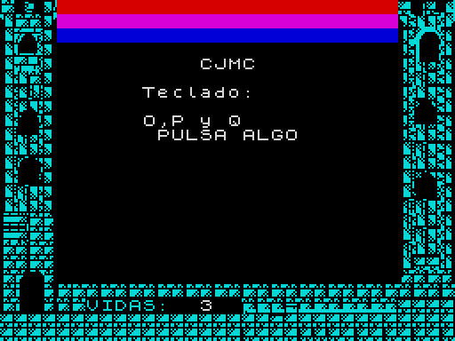
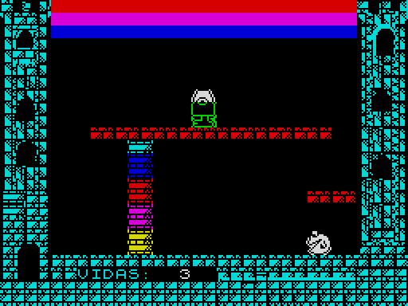
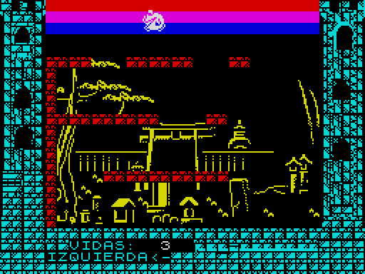
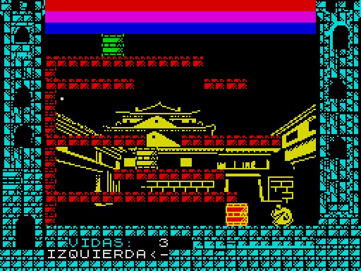
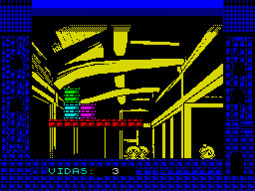
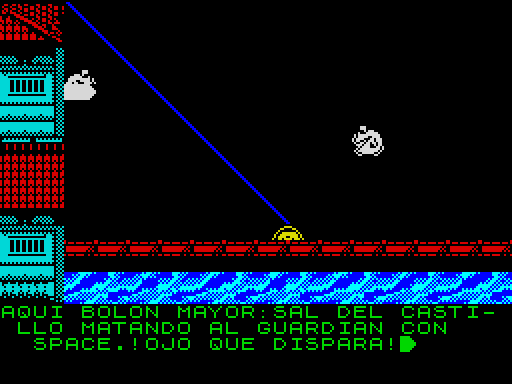

# CJMC93: a 1993 compiled BASIC game in C + splib2

*Classic Japanese Monster Castle '93* ("BY LOKO SOFT '93") is a platform
game written in Sinclair BASIC and compiled with ERE's compiler. It is the
first tape of two. You go through a castle room by room, ride moving
platforms, cross underground caves and, on the drawbridge, shoot the
guardian.

This is a port to C + inline asm for z88dk (classic, sccz80) with the
splib2 in this repository, **BITMAPBG** build (`splib2f.lib`):

* The player, the enemies and the moving platforms are masked sprites
  that move pixel by pixel, at 25 fps.
* Jumps follow an arc (gravity and acceleration from two tables) with the
  original's height, 6 characters.
* Each backdrop (castle, cave, drawbridge) goes **whole** into splib2's
  background buffer, the play area included. Paint anything on it: the
  sprites restore it as they pass.
* Rooms are made with the room editor (`tools/roomed`): chars,
  rectangles and patterns of tiles; BRIGHT is solid, FLASH deadly. Some also
  show a picture in the game area. A custom ZX0 decoder (`pic_unpack`)
  writes it line by line straight into the background buffer, with no
  intermediate buffer.
* Three functions do what the original repeated in every room:
  `room_draw ()`, `actors_move ()` (enemies and platforms) and
  `player_move ()`.
* No local variables, no function parameters: globals.

 
 
 

**[GAME.md](GAME.md)** describes the game section by section (TITLE, 1.1
to 1.8, 1.S, the cards, 2.1, 2.2, 3.1 to 3.3, 4.1, END, and the shared
PHYSICS, ACTORS, ROOM DRAWING...). Use its names to ask for changes.
**[BUGS.md](BUGS.md)** lists the original's bugs and what the port does
about them. Among them: room 3.1 had no way out, its balls couldn't kill
but an invisible spot could, and the player couldn't move at all in the
final fight.

**Controls** (as the original): **O** left, **P** right, **Q** jump;
**0** or **SPACE** fire (only in the last room).

## Building

```
./build.sh
```

You need the z88dk classic toolchain (see `../../docs/TOOLCHAIN.md`),
Python 3 (standard library only) and `../../splib2f.lib`
(`../../build.sh`). The [zx0](https://github.com/einar-saukas/ZX0)
compressor is needed only when a backdrop changes; the packed copies are
in `gfx/packed/`. The result is `cjmc93.tap`.

## Editing

| File | What it is |
|---|---|
| `gfx/texts.txt` | the rooms' texts: sets of `ROW COL ATTR "text"`, numbered; a room's header names its set. |
| `gfx/rooms.txt` | the rooms, from the room editor (compact encoding): a header (backdrop, picture, texts) and objects. BRIGHT = solid, FLASH = deadly. The format is at the top of the file. `conv.py` writes `gfx/tileset.png` for the editor. |
| `gfx/backdrops/castle.png`, `cave.png`, `bridge.png` | 256x192 in Spectrum colours (at most two per 8x8 cell) |
| `gfx/pictures/*.png` | decorations for the game area: 192 wide, up to 136 tall, one colour (light = ink, yellow on screen). Name one on a room's line in `rooms.txt` to show it there. |

Backdrop cells with more than two colours don't stop the build: the
converter keeps the two main ones and prints a warning with the cell.
| `gfx/sprites.png` | the figures, 16x24, top-aligned (white ink, red mask, black see-through) |
| `gfx/tiles.png` | block graphics (128-143) and UDGs A-U (144-164) |
| `gfx/font.png` | characters 32-127 |
| `src/cjmc93.c` | the game; tuning constants at the top |
| `src/printer.h` | everything that draws (tiles, texts, rooms, backdrops, pictures, sprites), in inline assembly that calls splib2's routines directly instead of through their C wrappers |

`tools/conv.py` (run by `build.sh`) turns these into `src/assets.h`.

## How the original was read

The tape has a BASIC loader, the UDGs, the backdrop (a screen copied to
the display by a 12-byte routine POKEd at 61913) and 27,552 bytes of
compiled code. The compiler leaves a line table, and each line's code is
calls to its runtime and the ROM calculator, in reverse Polish order. So
it can be turned back into BASIC:

* `tools/decomp.py`: decodes the compiled code into tokens (pushed
  numbers, variables, strings, runtime calls), line by line. Its comment
  lists the code patterns.
* `tools/listing.py`: turns the tokens back into BASIC expressions and
  statements: `orig/cjmc93.bas.txt`, 237 lines. The variable names are
  made up, since the compiler kept none.
* `tools/screen.py`: a tiny interpreter for the `PRINT`s of that listing.
  `tools/extract.py` used it once to make `orig/rooms-print.txt` (each
  room's `PRINT`s, which `tools/print2rooms.py` turned into
  `gfx/rooms.txt`) and the cave and
  bridge backdrops (which the original draws with code), and `conv.py`
  uses it to build the rooms.

`orig/` keeps the tape (`cjmc93.tzx`), its blocks (`blk0-3.bin`), the
memory after loading (`mem.bin`, read by `decomp.py`) and the listing.
`decomp.py` needs `z80dis.py` from `../phantomasa/tools`.
