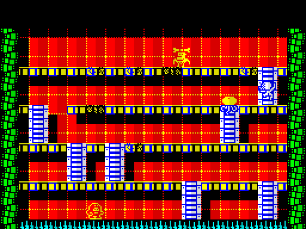
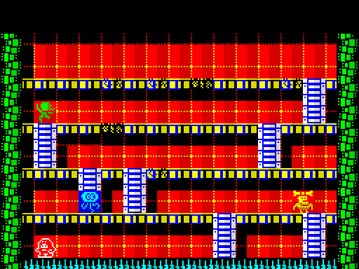
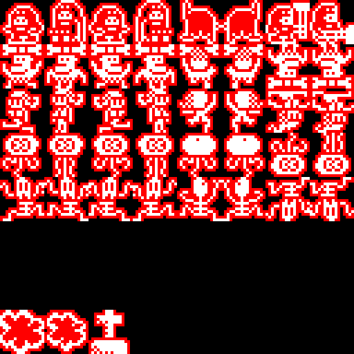
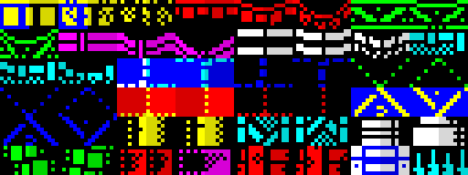

# Eleuterio — C port with splib2 in plain tile mode

*Eleuterio* ("big hamma platforming action!") is a Mojon Twins prototype for
the Radascompo 2010. It was written in Boriel's ZX Basic with
fourSpriter 2.1, whose sprites move 8 pixels at a time. This is a port to
**C + inline asm for z88dk (classic, sccz80)** with splib2: masked sprites
moving **pixel by pixel at 25 fps**.

 

*Left: this port. Right: the 2010 ZX Basic version.*

Unlike the other examples here, **this one doesn't use BITMAPBG.** Its
screen is made only of 8×8 tiles, which is exactly what stock Sprite Pack
does, so it links against **`splib2t.lib`**: this repository's library
built with `BITMAPBG = 0`. Nothing reads or writes the 6K shadow screen,
and the game uses that RAM for other things. §4 explains how, and also how
to get memory back when you *do* use BITMAPBG.

Controls: **O** left, **P** right, **Q** up the stairs, **A** down the
stairs, **SPACE** hammer, **H** restart the level. As in the original, a key
only counts when it is the only one pressed in its keyboard half-row.

## 1. The game

Four floors joined by stairs, and three enemies with different AIs.
Hammer the floor you're standing on: each blow cracks it a bit more, and
then it breaks and you fall to the floor below. An enemy that finds a hole
climbs in and fixes it. Stand on it and hammer it while it's working: each
blow costs it life and a bit of progress. At zero it falls through to the
floor below:

* landing on floor (or on the spikes at the bottom), it **dies with a
  "pop"** and disappears;
* landing on **another open hole**, it survives with half its life and
  starts fixing that hole straight away.

If an enemy **touches you**, you lose a life and the level starts again
from scratch. Enemies that are falling, fixing or popping don't hurt.
With no lives left, the game starts again from level 1 with
`START_LIVES` (3). Lives and level are shown at the top. When all three
enemies are gone, the next level in `levels.txt` starts (after the last
one, the first one again).

The original prototype stopped short of this: there was one level, the
player's life gauge was declared but unused, knocked-down enemies always
came back with half their life, and only the spikes killed them (leaving
a tombstone). The rules above finish it. **H** restarts the level.

## 2. Building

```
./build.sh          # Linux / macOS
make.bat            # Windows
```

You need z88dk classic (see [`../../docs/TOOLCHAIN.md`](../../docs/TOOLCHAIN.md))
and Python 3 (standard library only). `build.sh` builds `../../splib2t.lib`
with `../../build.sh tiles` if it's missing, or copies the one in
`../../prebuilt/`. The result is `eleuterio.tap`.

## 3. Developing the game

Three plain files hold the game's data. Edit them and run the build again;
`tools/conv.py` regenerates `src/assets.h` (never edit that one).

| File | What | Format |
|---|---|---|
| `levels.txt` | The levels | One block per level: four `floor` lines (stairs pattern such as `..##..#`, then the damage of the 6 breakable pieces, 0–12), three `enemy` lines (`ai=` `fix=` `life=` `speed=`) and a `tiles` line (which platform, background and frame tile sets). The file explains every field at the top. Add as many levels as fit. |
| `gfx/sprites.png` | Every sprite frame | 128×128 pixels, 8×8 frames of 16×16. Frame = row × 8 + column. Row 0 is Eleuterio, rows 1–4 the four enemy AI types, row 7 the "pop" (2 frames) and an unused tombstone; rows 5–6 are free, and empty frames take no memory. **White** = ink, **black** = see-through, **red** = solid paper (the mask). A frame with no red gets an automatic mask. |
| `gfx/tiles.png` | The 96 background tiles | 128×48 pixels, 16×6 tiles, **in Spectrum colours**. Two colours per tile, both normal or both BRIGHT; the higher palette index becomes INK, the lower PAPER. A one-colour tile is PAPER with INK 7. The converter stops with a message (tile number, column, row) if a tile breaks these rules. |





`gfx/tiles_ref.bin` is a cache written by the converter. It keeps the
exact bytes of tiles that haven't changed, which only matters for
one-colour tiles: you can't see their INK in the PNG. Leave it alongside
the PNG.

In `src/eleuterio.c`:

* All the numbers worth tuning are `#define`s at the top: speeds
  (`PLAYER_SPEED`, `ENEMY_FAST`, ...), `TICK_FRAMES` (the length of one
  "turn" of the original), `HAMMER_STRENGTH`, the play-area limits, and the
  delay between levels.
* The header comment covers the conventions (no local variables, few
  parameters, everything in pixels), the memory map, and a **who clobbers
  what** table of the shared globals.
* The player and the enemies are state machines with numbered states.
  The states are listed above `move_player` and `move_enemies`, and each
  state's code is commented. The enemy AI is split into `enemy_notice`
  (does it see you?), `enemy_decide` (where to go next), and
  `enemy_random_state`.
* The level is drawn by `draw_level` (the original `drawHammerinLevel`,
  ported as it was, quirks marked `sic`). Damage to the floor is redrawn
  in `player_hit_floor` and `enemy_restore_piece`.

## 4. Not using the bitmap buffer, and getting its RAM back

### 4.1 Tile mode: `splib2t.lib`

`BITMAPBG` is a compile-time option of the library (`SPconfig.def`). With
`BITMAPBG = 0` the library is plain Sprite Pack 2.2: `SPUpdateNow` draws
each cell's background from the tile graphic that the cell's tile number
points to. It never touches the shadow screen. `sp_BgCapture`,
`sp_BgShow`, `sp_BgAddr` and `sp_BgPutTile` do nothing; `sp_BgAttrFill`
(every attribute + everything dirty) and `sp_ZX0` still work.

```
../../build.sh tiles        # -> ../../splib2t.lib (SPconfig.def is not changed)
```

Both libraries use the same `spritepack.h`, so a program picks one only
at link time (`-lsplib2f` or `-lsplib2t`). With tiles, the background
calls are the classic ones:

```c
sp_TileArray(n, graphic);                 /* tile n draws these 8 bytes   */
sp_Initialize(attr, blank_tile);          /* clear the screen to a tile   */
sp_PrintAtInv(row, col, attr, n);         /* put a tile; redrawn next update */
sp_ClearRect(&rect, attr, n, sp_CR_TILES);
```

That is all `draw_level` and the platform damage use (`put_char` in
`src/eleuterio.c`).

### 4.2 What the freed 6K are used for here

With BITMAPBG, `$D800-$EFFF` is the shadow screen, so the stack and
splib2's block memory have to live below `$D800`. That leaves the program
less room (Lhikoj and CJMC3 must end below about `$D4C0`). Here:

```
$5E88 - $B520  binary: code, splib2, assets (may grow up to $D7FF)
$D800 - $DA75  splib2 block memory (42 blocks x 15: 4 sprites + ISR hook)
$DA76 - $DAD6  game buffers: big tiles (32 bytes) and level grid (65 bytes)
$DAD7 - $EDFF  FREE: about 4.9K, FREE_RAM .. FREE_RAM_END in the source
$EE00 - $EFFF  stack (512 bytes; #pragma output STACKPTR=61440)
$F000 - $FFFF  IM2 table, ISR, rotation tables (fixed by splib2)
```

* **Stack**: `#pragma output STACKPTR=61440` puts its top at `$F000`, just
  under the IM2 table.
* **Block memory**: `sp_AddMemory(0, NUMBLOCKS, 14, 0xD800)`.
* **Buffers at fixed addresses**: `bigtiles` and `grid` are pointers set to
  addresses in that area, so they take no space in the binary or on the
  tape. Use pointer variables, as here: sccz80 miscompiles
  `((char *) CONSTANT)[i]`.
* **Free RAM**: `FREE_RAM` to `FREE_RAM_END` (about 4.9K) is unused. It's
  room for decompression buffers, music, more levels, a title screen. The
  binary itself can also grow up to `$D7FF`: `build.sh` prints where it
  ends.

### 4.3 If you need BITMAPBG and still need RAM

When the game does need bitmap backgrounds, these are the options, from
cheapest to most involved:

1. **Use the shadow as scratch while it doesn't matter.** Between
   deciding to change the screen and painting the new background, the
   shadow's contents are going to be overwritten anyway. In that window it
   is 6K of free buffer: Lhikoj runs its flood fill's queue on a 3K stack
   at the top of the shadow (`sp_VecConfig(0, SP_BGSHADOW + 6144, 1000)`).
   A level decompressor could unpack there, as long as it's done before
   the background is drawn.
2. **Use the thirds you don't show.** If a screen only manages some rows
   (`SP_ROWSTART`/`SP_ROWEND` in `SPconfig.def`, e.g. a static score panel
   at the bottom), the part of the shadow behind unmanaged rows is never
   read. With the display-file layout, a whole unused third
   (`sp_BgThird(2)`) is a contiguous 2K block. Don't call `sp_BgCapture`
   or `sp_BgShow` then: they copy all 6K.
3. **Move the shadow.** `BGSHADOW` in `SPconfig.def` (plus `SP_BGSHADOW`
   before including `spritepack.h`) puts it at any 256-byte boundary.
   That doesn't free anything, but it lets you lay out memory around it,
   e.g. to keep a big contiguous block for something else.
4. **Don't use BITMAPBG for screens that don't need it.** The option is
   per library, not per screen. If most of a game is tiles, a tile-mode
   build with your own code for the odd bitmapped screen (drawn outside
   splib2, while no sprites are shown) may be the better trade.

## 5. Differences from the ZX Basic version, and what's left to do

* **Pixel movement.** fourSpriter moved sprites a character per main loop.
  Here they move `PLAYER_SPEED` / `ENEMY_FAST` / `ENEMY_SLOW` pixels per
  frame at 25 fps, always ending on the 16×32 px level grid where the
  original's decisions happen, so the logic is unchanged. Timed actions
  (hammer blows, fixing, explosions) count ticks of `TICK_FRAMES` frames
  where the original counted main loops.
* **Sprite colours.** fourSpriter coloured each sprite (the enemy type's
  colour, and magenta flashing when an enemy chases you). This fork of
  splib2 doesn't colour sprites: they take the attribute of the cells
  they're on. To bring colours back, re-enable the commented
  `coloursprite` code in `../../updater/SPUpdateNow.asm` and set each
  sprite char's `colour`. A chasing enemy could then flash again.
* **Finished game rules** (lives, deaths, pop, next level, HUD), described
  in §1. The tombstone frame (58) is no longer used; it's still in the
  sheet.
* **HUD text** uses the ROM font: tiles `TEXT_TILE` (128) onwards point at
  the ROM's characters, so no font is stored.
* **To do**, for whoever continues: more levels in `levels.txt`, enemy AI
  types 4–5 (only described in `orig/design.txt`), a title screen, a score,
  sound beyond the BEEP clicks.

## 6. Files

```
build.sh, make.bat     build: convert data, compile, make the tape
eleuterio.tap          the game
levels.txt             the levels (edit)
gfx/sprites.png        sprite sheet (edit)
gfx/tiles.png          tile set (edit)
gfx/tiles_ref.bin      converter cache for tiles.png (keep)
src/eleuterio.c        the game
src/assets.h           generated
tools/conv.py          converter; tools/png.py: PNG reader/writer
orig/                  the 2010 ZX Basic sources, gfx data and design notes
shots/                 screenshots
```

Credits: Eleuterio by The Mojon Twins (2010). fourSpriter by na_th_an.
