# Ghost Embustes 2: a 1990 BASIC game in C + splib2

*Ghost Embustes 2* ("© 1990 by Loko soft", by jose luis) is a Ghostbusters
game written in Sinclair BASIC by a kid. It's a chain of small games:

1. Drive the Ghost-tipo home.
2. Buy equipment.
3. Shoot a ghost.
4. Watch night fall on the city.
5. Get through three platform screens (Gregory), five chambers of spikes,
   a room of mines, falling rocks and an electric fence, a room of spikes
   and another fence, a "come-come" against the clock, and the sea with its
   ghost.
6. Choose a character for the next part, which was never written.

This is a port to C + inline asm for z88dk (classic, sccz80) with the
splib2 in this repository, in **tile mode** (`splib2t.lib`: no shadow
screen). Everything that moves is a masked sprite moving pixel by pixel at
25 fps: the little man, the car, the ghosts, the rocks and the moving
platform.

The original had **a lot of bugs**: several crashes, walls that weren't
walls, a platform game without gravity, a come-come you won by standing
still, a mine detector that nearly always said "nothing near"...
[BUGS.md](BUGS.md) lists every one with its BASIC line and what the port
does about it.

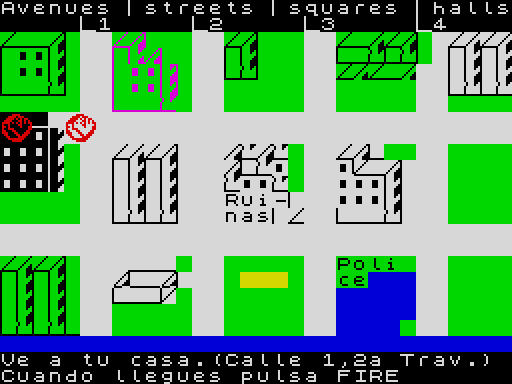 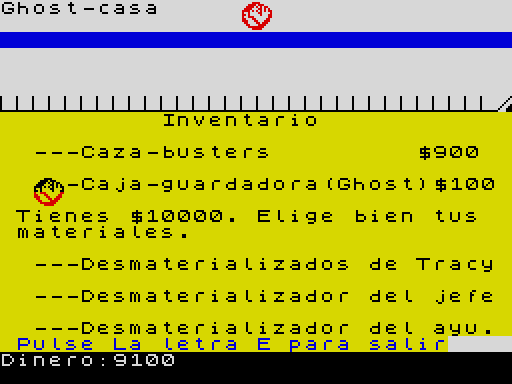 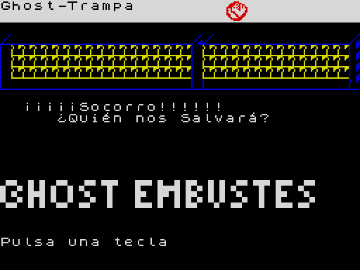
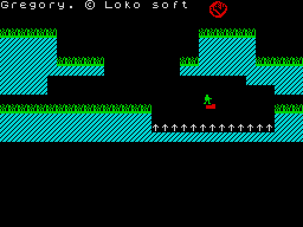 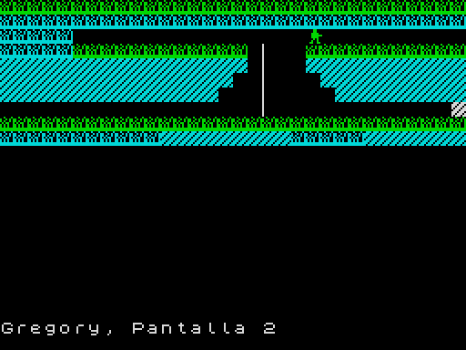 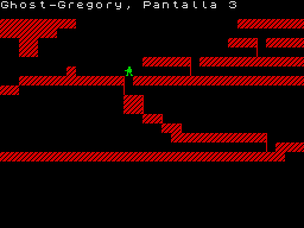
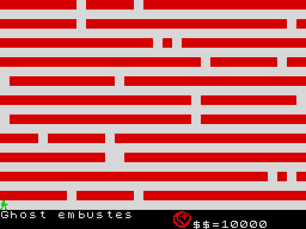 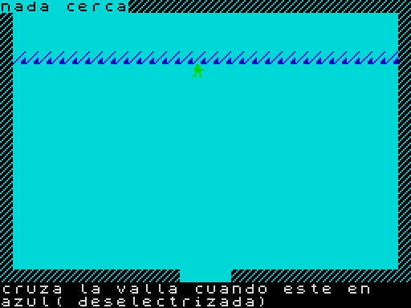 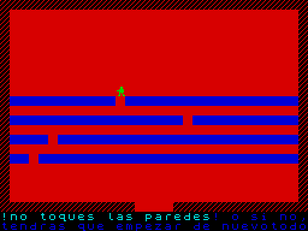
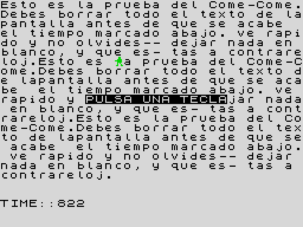 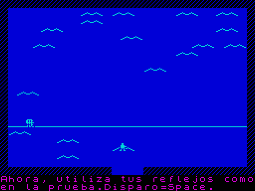

**Controls**, as in the original, a Sinclair joystick:

| Keys | Action |
|---|---|
| **6** / **7** | left / right |
| **8** / **9** | down / up |
| **0** | FIRE |
| **Q A O P** and **SPACE** | the same, as an alternative |
| **E** | leave the shop |
| **S** / **N** | answer "¿Quieres repetir la fase?" |
| **T** / **J** / **A** | choose a character at the end |

## Building

```
./build.sh
```

You need:

* z88dk classic (see [`../../docs/TOOLCHAIN.md`](../../docs/TOOLCHAIN.md));
* Python 3 (standard library only).

The result is `ghostembustes2.tap`, a 48K game.

* `build.sh` builds `../../splib2t.lib` if it's missing.
* The [zx0](https://github.com/einar-saukas/ZX0) compressor is only needed
  when a screen changes. Packed screens are cached in `gfx/packed/`. Set
  `ZX0=/path/to/zx0` if it isn't in the `PATH`.

## Developing it

Everything is a plain file. Edit, run `./build.sh`, and `tools/conv.py`
re-imports it all into `src/assets.h`.

| File | What |
|---|---|
| `gfx/screens/NN-name.png` | The static screens: street, shop, the logo of the song, the city, the three Gregory screens. 256×192, Spectrum colours, two colours per cell. The game shows them as `SCR_NAME`. Each cell becomes a character of the font or the tile set; a cell that matches none becomes a new tile automatically. |
| `gfx/font.png` | Characters 32-127 (the ROM font). |
| `gfx/tiles.png` | Characters 128-255: the block graphics (128-143), the game's UDGs A-U (144-164), á é í ó ú ñ ¡ ¿ and the waves (165-175). The code prints them by number (`T_*` in the source). |
| `gfx/sprites.png` | 16×16 frames, 8 per row: white ink, red mask, black clear. Frame names are `F_*` in the source. |
| `texts.txt` | Every text, in UTF-8 with real accents. The format is at the top of the file. |
| `src/ghostembustes2.c` | The game. Tunable numbers are `#define`s at the top. Each part is a function named after it, with its BASIC line numbers. |

How the parts work:

* **Collisions** come from the characters on screen:
  * T (bricks, walls) is solid;
  * `^` (spikes, mines) kills;
  * in Gregory, S (grass) is solid too and F (the poles) are ladders;
  * in the street, only the road (blank cells with white paper) can be
    driven on.
* **Top view** parts move you from cell to cell, smoothly, choosing a
  direction each time you're lined up with a cell. That's what makes the
  one-character gaps in the spikes passable without pixel-perfect aim. A
  cell kills you only when it's under the little man's centre pixel.
* **Sprites take the colours of the cells they're on.** Each part sets the
  ink of the blank cells to the colour the original printed the sprite
  with (green man, red car, magenta ghost).

`tools/extract.py` and `tools/grab.py` are the one-offs that made `gfx/`
from the original: they run its BASIC in an emulator (SkoolKit) and save
its screens. You don't need them to build.

## Memory (48K)

```
$5E88 - ~$D040  the program: code, splib2, assets, display list
$D800 - $DA75   splib2 block memory
$DA76 - $E075   buffer a packed screen is depacked into
$E076 - $EDFF   free (about 3.4K)
$EE00 - $EFFF   stack
$F000 - $FFFF   splib2 (IM2 table, ISR, rotation tables)
```

The 7 screens pack to about 1.1K altogether.

## Differences from the original, besides the bug fixes

* **Gregory** is a real platform game: gravity, ladders, a jump of 3
  characters up and 6 across (like line 9200's), and a moving platform you
  ride.
  * Long falls and spikes kill. You then repeat that screen; the original
    went back to the start of the game.
  * At the top of screen 2's pole, the jump goes forward under the low
    ceiling. That's how you cross the gap there, which the original jumped
    with a hard-coded move (line 3980).
* **The jump** (FIRE) only exists in Gregory. The original had it
  everywhere, by accident.
* **Bottom lines:** the messages of the original's lower screen ("PRINT
  #0") are on rows 22-23.
* **Speed:** a cell takes 4 frames to cross, about the original's speed.
  Long beeps (the typewriter's full stops, the tunes) still stop the game,
  as they did.
* **The end:** the original then asked for the next tape ("CARGA OTRA
  FASE"). The text is kept; a key starts again.
