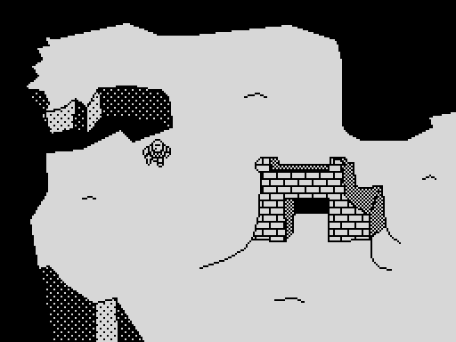

# Phantomas Lhikoj — C + inline asm port (z88dk + splib2, bitmap backgrounds)

This is a port of the abandoned ZX Basic (Boriel) *Lhikoj* prototype to C for
**z88dk (classic, sccz80) + splib2 (Sprite Pack 2.2)**. It uses:

* **Vector backgrounds**: the Suvleir 3.0 screens (lines, plots and SPPFill
  patterned fills), drawn at run time as in the original.
* **Pixel-by-pixel masked sprites** at a **fixed 25 fps**, drawn by the
  splib2 in this repository built with `BITMAPBG = 1`, which takes each
  cell's background from a **bitmap** instead of a tile.

The playable flow is complete: intro cutscene, overworld (9 screens,
connections and hotspots), Le Vielho, the 4 ice-cave mirror puzzles, the
Obonabilobo counter, and the second cutscene that takes you to world 4.



---

## 1. How it uses splib2 BITMAPBG

The library side (the shadow screen, how `SPUpdateNow` reads it, and
`sp_BgCapture` / `sp_BgShow` / `sp_BgAddr`) is documented in the repository's
[`README.md`](../../README.md) and [`docs/BITMAPBG.md`](../../docs/BITMAPBG.md).
This section covers only what the game does with it.

| Need | How |
|---|---|
| New screen | Clear the screen, draw the vectors **on the real screen** (lines and `SPPFill` work on `$4000`), then `sp_BgCapture()`. That copies the bitmap to the shadow and the attributes to the display list, and marks every cell dirty. |
| Draw over the current background (message box) | `sp_BgShow()` (shadow → screen, which removes the sprites), draw on the screen, then `sp_BgCapture()`. Sprites are hidden first so they don't get captured. |
| Put a char/tile or text into the background | Write straight into the shadow (`cell_addr()`, which is the same as `sp_BgAddr()`), set the attribute in display-list byte 0, then invalidate the cell (`put_char`, `print_at`). |
| Save/restore the message area | The shadow uses screen layout, so the middle third is one contiguous 2K block: a single `ldir`. Its 256 display-list attributes are saved alongside. |
| Effects outside sprite areas | The intro sky scroll works directly on the real screen's top third. Nothing invalidates it, so splib2 never overwrites it. |
| Collision map | Stored in the display list's **tile byte** (`dlist[cell*4+1]`). BITMAPBG doesn't use that byte, so this saves 768 bytes. `sp_VecDraw(screen, dlist + 1, 4)` decodes it there directly. |
| Vector screens | `gfx/*.svl`, made with Suvleir 4 (`tools/suvleir4`) and drawn by `sp_VecDraw`. `sp_VecConfig(0, SP_BGSHADOW + 6144, 1000)` runs the fills on a 3K stack at the top of the shadow screen. The original `draw.exe` files are in `orig/legacy-screens/`; they were converted with `suvleir4 -convert`. |

---

## 2. Memory map (48K)

```
$5B00-$5BFF  msg_attrs (printer buffer)              256
$5E88-~$D275 binary (org 24200): code, data, splib2, display list (3K)
   ...-$D5C0 stack (grows down; max depth measured ~110 bytes)
$D62F-$D7FF  splib2 block memory: 31 blocks x 15 (3 sprites x 10)
$D800-$EFFF  SHADOW: background bitmap, screen layout     6144
             (also the temporary stack for SPPFill, see below)
$F000-$F100  IM2 vector table
$F101-$F1C0  ice_map (16x12 tiles) in the free gap
$F1F1-       splib2 generic ISR
$F200-$FFFF  splib2 horizontal rotation tables
```

`build.sh` prints where the binary ends. The stack starts at `$D5C0`, and
the measured depth is about 110 bytes. **Keep the binary below about `$D4C0`.**
Everything above is fixed by splib2 or by this map.

### Tricks used to fit

* **Flood fill on a borrowed stack.** `SPPFill` keeps its queue on the stack
  (3·depth+30 bytes; the ZX Basic port used depth 300, about 930 bytes).
  `sp_VecConfig()` makes `SPVecDraw` switch `SP` to the top of the shadow
  (`$F000`) during fills.
  The shadow is always recaptured after drawing vectors, so this costs
  nothing, and the fill gets depth 1000 (about 3 KB) for free.
* **Hardness map in the display list tile byte.** `dlist[cell*4+1]`, decoded
  straight there by `sp_VecDraw(screen, dlist + 1, 4)`.
* **No blank third sprite column per frame.** A 16 px wide sprite needs 3
  columns so it can shift 0–7 px. The third column's char structs point at
  `SPNullSprPtr`, which `SPMoveSprAbs` never animates, so each frame stores
  only 2 columns (96 bytes instead of 144). This is the same trick as MK1's
  `fix_sprites`.

---

## 3. Sprites

* Frames are generated by `tools_conv.py` from the original 8x8 sprite set:
  12 overworld frames (4 directions × 3) and 2 × 4 ice-cave frames.
* **Masks are automatic.** Pixels outside the outline (flood-filled from the
  edges) are transparent, except for a 1 px halo around the ink. The inside of
  the figure is solid, so sprites read well over the dithered fills.
* Data layout per frame: column A (16 lines + 8 blank) then column B (16 lines
  + 8 blank). Each line is 2 bytes (graphic, mask). There are 8 blank lines
  before the first frame. The blank tails act as the top padding of the next
  column, which splib2 needs for 0–7 px vertical shifts.
* Animation uses splib2's displacement trick: `sp_MoveSprAbs(..., new_frame -
  current_frame, ...)`. All frames have the same stride (96 bytes).
* Positions are in pixels: `row = y>>3, col = x>>3, hpix = x&7, vpix = y&7`.
  To hide a sprite, move it to column 34 (outside the clip).

---

## 4. Timing

The ISR hook increments `isrc`. `wait_frame()` waits for 2 interrupts and then
the game calls `sp_UpdateNow()`, giving **25 fps**. This was verified in the
emulator: the player moves 2 px per update, 20 px every 20 interrupts. The
intro sky scrolls 8 px per update, as in the original. Two masked 16×16
sprites in the ice caves stay well within the frame budget.

---

## 5. Game logic changes from the BASIC version

The original moved in 8 px steps. This port moves pixel by pixel:

* **Speeds are constants** at the top of `src/lhikoj.c`: `MUNDO_HORZ_SPEED`,
  `MUNDO_VERT_SPEED` (overworld, must divide 8), `INTRO_WALK_SPEED` (must
  divide 104), and `PLATAFORMAS_HORZ_SPEED`, `PLATAFORMAS_VERT_SPEED`,
  `PLATAFORMAS_JUMP_HEIGHT`, `PLATAFORMAS_EXIT_SLACK` (ice caves; speeds must divide 16). Overworld speeds of
  2 and 4 have been played through in the emulator.

* **Overworld**: 2 px per frame, 16×16 collision box against the hardness map
  (value 1 = wall, as in `gpIsHard`). Added **corner sliding**: if you are
  blocked but less than half a cell off a free row or column, you get nudged
  into it, so pixel movement doesn't snag on 2-cell corridors. Connections and
  hotspots use the rounded char position `(p+4)>>3` against the original
  tables, which are copied verbatim from `lhikoj.bas`.
* **Ice caves**: horizontal 2 px/frame, vertical 4 px/frame. A jump lasts
  12 frames × 4 px = 48 px (3 tiles, as in the original). The bottom twin
  mirrors gravity. **Exit** needs both twins on the ground, standing on (or,
  for the bottom twin, hanging from) an EXIT tile with any part of the
  sprite: the tile is checked ±`PLATAFORMAS_EXIT_SLACK` (8) pixels around
  the centre, so no exact alignment is needed. **Death** is when
  the inner 10×10 of either twin touches a spike tile.
* **Messages**: sprites are hidden while a message box is up, and the box's
  attributes are reset to black-on-white. The ZX Basic version cleared them
  too, but then lost Le Vielho's blue. Here they are saved and restored.
* All-zero rows in the connection table are skipped. In the original, standing
  on cell (0,0) would warp you to screen 0.
* Text uses the ROM font with Boriel's exact BOLD (`c | rlc c`) and ITALIC
  (rows 0–2 `srl`, rows 5–7 `sla`) transforms.
* Lines use the same Bresenham decisions as Boriel's `DRAW`, so the fills see
  the same boundaries. The intro screen looks identical to the original's
  when the two are compared side by side.

Controls are as in the original: **Q A O P** to move, **SPACE** to jump or skip
the intro, **Y/N** after dying in a cave.

---

## 6. Gotchas found along the way (read before extending)

1. **`sp_AddMemory` before `sp_RegisterHook`.** Hook registration allocates
   through `u_malloc`.
2. **A splib2 ISR hook needs 2 spare bytes in front of it.** The generic ISR
   stores its hook list link there. A plain C function will corrupt whatever
   precedes it, so the hook is written in asm after a `defw 0`.
3. **`SPNullSprPtr` is recognised by page.** `SPMoveSprAbs` skips any graphic
   pointer whose MSB equals `SPNullSprPtr/256`. Never put sprite frames in the
   same 256-byte page as `SPNullSprPtr`.
4. **sccz80 (1.10) miscompiles indexing a cast constant.** It compiles
   `((unsigned char *) 0xF101)[i]` as `*(0xF101)` and ignores `i`. Use a
   pointer variable instead.
5. **No local variables.** sccz80 1.10 handles locals badly, so every
   function uses shared global helpers (`gx gy gi gj gk gc gt ga gb gd ge gf`,
   `gw gw2`, `gp gp2 gp3 gp4`). The comment block after their declaration in
   `lhikoj.c` lists which function clobbers which. A caller must not keep one
   live across a call that clobbers it; two bugs during the port were
   exactly this.
6. Drawing on the real screen while sprites are visible leaves sprite pixels
   in the bitmap. Always `sp_BgShow()` first if you are going to call
   `sp_BgCapture()`.
7. **Toolchain**: see [`docs/TOOLCHAIN.md`](../../docs/TOOLCHAIN.md).

---

## 7. Building

First build the library at the repository root (`Makefile.bat` or
`build.sh`; see the main README). Then, from this folder:

```
./build.sh      (Linux / macOS)
make.bat        (Windows)
```

The example links against `../../splib2f.lib` and includes
`../../spritepack.h` straight from the repository, so nothing needs
installing into z88dk.

The build runs `tools_conv.py` (Python 3). It reads the original `.bas` files
in `orig/` and the `.svl` screens in `gfx/` and writes `src/assets.h`. It then
runs:

```
zcc +zx -vn -m -unsigned -zorg=24200 -I../../.. -l../../../splib2f -o lhikoj.bin lhikoj.c
appmake +zx -b lhikoj.bin -o ../lhikoj.tap --org 24200     (loader does CLEAR 24199)
```

`gfx/sprites_preview.png` shows the generated frames and masks.

### Verified

All of this was run in the SkoolKit Z80 simulator, from the TAP, with scripted
keypresses and BFS navigation over the in-memory hardness map:

* intro and skip;
* screen changes 0→1→2→1;
* locked door message;
* Le Vielho opening the caves (OB counter);
* ice cave entry, jump, death + retry, exit + Obonabilobo;
* Vielho with 4 Obonabilobos → cutscene 2 → world 4.

A stack canary showed a maximum stack depth of about 110 bytes.

---

## 8. Files

```
src/lhikoj.c            the game (C + inline asm)
src/assets.h            generated data (do not edit)
tools_conv.py           asset converter (sprites+masks, charset, vectors, ice levels, tables)
gfx/*.svl               vector screens (Suvleir 4); gfx/c-scrollablesky.bin is the aPLib sky
orig/legacy-screens/    the original draw.exe (Suvleir 3) screens
orig/*.bas              original ZX Basic sources the converter reads
build.sh / make.bat     build scripts
lhikoj.tap              ready to run (prebuilt)
shots/                  emulator screenshots
```
