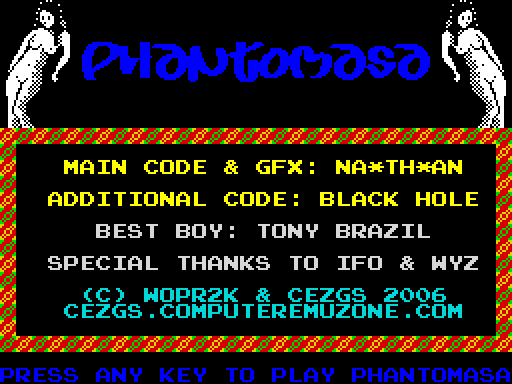
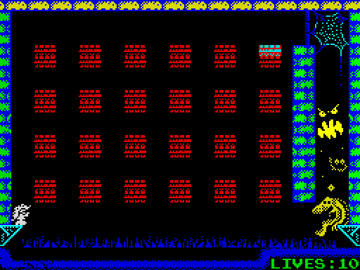
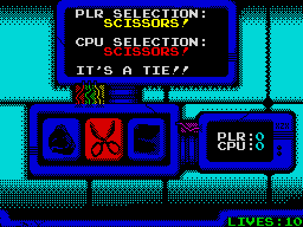
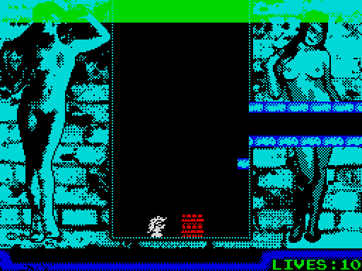

# Phantomasa — the whole game in one load (128K), C + splib2-bitmapbg

*Phantomasa* (na_th_an / The Mojon Twins + Black Hole, © WOPR2K & CEZGS
2006) shipped as two compiled-BASIC tapes for the 48K:

* **Part 1:** the intro and stage 1, *Moving Blocks* (9 rounds). Finishing
  it gives you an access code.
* **Part 2:** stage 2, *Jan-Ken-Do* (rock-paper-scissors against the
  security system), stage 3, *The Snotty Maze* (8 rounds), and the ending.

This port puts **both parts on one tape, loaded once**, on the 128K. It is
C + inline asm for z88dk (classic, sccz80) with the splib2 in this
repository:

* **Pixel-by-pixel masked sprites at 25 fps** (the player, the box being
  pushed, the moving platforms) over the original full-screen pictures,
  using splib2's BITMAPBG shadow screen.
* **Every screen is ZX0-packed** in the 128K's extra RAM banks and depacked
  straight to the screen when it's needed.
* **The original music**: the game's own beeper player and songs, called
  note by note as the BASIC did.

 
 

Controls, as in the original: **O** left, **P** right, **Q** jump, **R**
give up the round (lose a life). In Jan-Ken-Do: **O**/**P** choose, **SPACE**
or **ENTER** play. A key skips the intro and the ending.

Load it in **128K mode** (the "Tape Loader" option). In 48K BASIC the
memory paging is locked.

---

## 1. Building

```
./build.sh
```

You need z88dk classic (see [`../../docs/TOOLCHAIN.md`](../../docs/TOOLCHAIN.md))
and Python 3 (standard library only). The result is `phantomasa.tap`.

* The game needs splib2 with a different memory layout (§4).
  `build.sh` makes it as `../../splib2hi.lib` if it's missing:
  `../../build.sh variant splib2hi BGSHADOW=$C8 SProtatetbl=$E000 IM2TABLE=$E000`.
* The [zx0](https://github.com/einar-saukas/ZX0) compressor is only needed
  when a screen changes. Packed screens are cached in `gfx/packed/`. Set
  `ZX0=/path/to/zx0` if it isn't in the `PATH`.

## 2. Developing the game

Everything is a plain file. Edit, run `./build.sh`, and `tools/conv.py`
re-imports it all.

| File | What | Notes |
|---|---|---|
| `gfx/screens/NN-name.png` | every screen: intro and outro pictures, title, the 9 rounds of stage 1, the two mazes of stage 3, Jan-Ken-Do, the CEZ logo | 256×192, Spectrum colours, at most two colours per 8×8 cell, both normal or both BRIGHT. **Collisions come from the colours** (below). Add screens by adding files: the number orders them, the name becomes `SCR_NAME` in the code. |
| `gfx/sprites.png` | the sprites | 96×16, six 16×16 frames: player facing left, left step, right, right step, box, moving platform (top 8 lines). White = ink, black = see-through, red = solid paper (mask). A frame without red gets an automatic mask. |
| `gfx/font.png` | the font | 128×48, characters 32–127. The lower case letters are graphics: box `e f / g h`, portal `i j`, exit walls `l m n o`, platform `p q`, sparkle `z`. |
| `rounds.txt` | every round | screen, start, exit, boxes, portal, platform, snot, door, extra tiles. The format is explained at the top of the file. Stages run in file order: stage 1 rounds, then Jan-Ken-Do, then stage 3 rounds. |
| `gfx/music.bin` | the original music player and songs | binary, loaded at `$F600` (§4) |

**Collisions from colours** (as the BASIC tested them with `ATTR`):

| Cell colour | Means |
|---|---|
| white ink on black paper, not BRIGHT (attribute 7), including all-black cells | free space |
| blue ink on black (attribute 1) | kills you when you stand on it, if every cell under your feet is like that |
| anything else | solid |

A PNG can't show which of a cell's colours is INK and which is PAPER, or
what the INK of a plain-colour cell is. So `gfx/screens/ref/*.scr` keeps
the exact original bytes: **cells you don't change keep them**. For
changed cells, the higher palette index is INK; a one-colour cell is PAPER
with INK 7, so a black cell is free space.

In `src/phantomasa.c` the tunable numbers (speeds, the jump arc
`jump_tab`, lives, `TICK_FRAMES`, portal flash rate) are `#define`s and
tables at the top. The header comment has the memory map and the
conventions, and there is a **who clobbers what** table for the shared
globals. Each scene (intro, title, round cards, Jan-Ken-Do, outro, game
over) is a function named after the BASIC lines it replaces.

`tools/extract.py` is the one-off that pulled every screen, the font, the
UDGs and the music out of the original tapes, by running the game's own
routines in an emulator (SkoolKit). It's kept to document where the data
came from. You don't need it to build.

## 3. One load: what fits where

The packed screens take **36,425 bytes**. The program itself (code,
splib2, display list, rounds, tables) takes **about 22 KB**, from $5E88 to
about $B4E5.

**On a 48K it can't be one load, and redrawing the backgrounds wouldn't
change that.** With BITMAPBG the shadow screen takes $C800-$DFFF and
splib2's tables take $E000-$EFFF. The music player is at $F600-$FC57.
That leaves $5E88-$BFFF plus about 3 KB of gaps, around 28 KB, and the
program uses 22 KB of it. About 6 KB would be left for 24 screens, or
roughly 250 bytes each, and even the simplest stage 1 round packs to
730 bytes. Two loads on a 48K, as the original did, don't fit either:
part 1's 16 screens pack to about 20 KB on their own.

**On a 128K everything fits, with room to spare.** RAM banks 1, 3, 4, 6
and 7 are 16 KB each, paged in at $C000. The screens fill bank 1 (16,343
bytes), bank 3 (15,370) and part of bank 4 (4,712). That leaves about
11.6 KB in bank 4 and all of banks 6 and 7 (32 KB) for new screens.
`tools/conv.py` puts each screen whole into the first bank where it fits,
in file order, and stops with a message if they run out.

So the screens don't need redrawing. Simpler screens would only matter
for a 48K version, and even then they'd have to pack to about 250 bytes
each.

## 4. Memory map and how the parts fit together

```
$5E88 - ~$B4E5  the program (org 24200)            } always there
   ...  - $BFFF  stack (grows down from $C000)       } (banks 5 and 2)
$C000 - $C1D0   splib2 block memory (31 x 15)       } bank 0, normally
$C800 - $DFFF   SHADOW screen (BGSHADOW = $C8)      } paged at $C000
$E000 - $E100   IM2 vector table                    }
$E1E1           splib2's generic ISR                }
$E200 - $EFFF   splib2 rotation tables              }
$F000 - $F2FF   font                                }
$F300 - $F5FF   sprite frames                       }
$F600 - $FC57   the original music player + songs   }
banks 1, 3, 4   packed screens
```

* **Why splib2 is moved**: the music player is the original binary and
  its addresses are fixed ($F600-$FC57). splib2's default layout puts its
  rotation tables at $F200-$FFFF, on top of it. So this game uses a
  variant of the library (`splib2hi.lib`, made with `build.sh variant`)
  with the tables and IM2 table at $E000 and the shadow at $C800.
* **Paging**: while another bank is at $C000, none of bank 0 is there:
  not the shadow, the IM2 table, the font or the music. So
  `show_screen()` runs with interrupts off, on a small stack below $C000,
  pages the screen's bank in, depacks to $4000 (which is always there),
  and pages bank 0 back. The program and its stack are below $C000, so
  they are always visible.
* **Showing a round**: the picture is depacked to the real screen. The
  things the BASIC printed on top (boxes, portal, exit walls, extra
  tiles) are drawn on it. Then `sp_BgCapture()` makes it splib2's
  background, and the collision map is built from the attributes into
  the display list's tile byte. From then on everything goes through the
  shadow: a pushed box's tiles, the snot rows, the flashing portal, the
  HUD, the death sparkles.
* **Other scenes** (intro, title, Jan-Ken-Do, outro) draw straight on the
  real screen, with the sprites out of the way, and never call
  `sp_UpdateNow`.
* **Loading**: the BASIC loader (`tools/mktap.py`) does `CLEAR 24199: LOAD
  ""CODE: RANDOMIZE USR 24200`. The program's first job,
  `load_blocks()`, reads the headerless blocks that follow on the tape
  with the ROM's LD-BYTES:
  * `build/high.bin`: font, sprites and music, to $F000;
  * the bank files, each with its bank paged in.

  `load_table` in `assets.h` lists them.

## 5. Gameplay notes and differences

* **Movement**: the original moved a character per main loop. Here it's
  pixel by pixel: walking 2 px/frame and falling 2 px/frame. Jumps are
  48 px, the original's 6 characters, on an arc (fast at first, slow at
  the top). The platform moves at half the player's speed, as in the
  original.
* **Boxes come only from `rounds.txt`**, never from the pictures. The game
  keeps their positions in a list (`box_y`, `box_x`) and updates it when
  one is pushed. Red things painted in a screen are scenery and are just
  solid. (The original tested `ATTR = 2`, so red scenery such as round
  9's flower could be "pushed" in halves. None of the screen pictures has
  a box drawn in it: every box is placed by `rounds.txt`.) A box with
  something printed over it (the portal in stage 1, round 2) can't move.
* You push a box only when your rows match its rows exactly,
  and those rows start on the round's box parity (even in stage 1, odd in
  stage 3), as the original's `INT (W/2)` test required. Without the
  parity check, standing between two stacked boxes would push the bottom
  half of one together with the top half of the other. All boxes of a
  round must start on rows of the same parity (`conv.py` checks). The box moves one character
  at a time, sliding as a sprite. As in the original, the space it leaves
  becomes blank, and boxes don't fall.
* **Moving platforms** carry you. They are sprites and solid.
* **Snot** (stage 3): a row every `speed + 1` ticks (4 frames each). It
  turns the row green and solid, and kills you when it reaches your head.
* **Portal**: the original used FLASH. In this splib2 the attribute's
  FLASH bit means "no sprites in this cell", so the portal's colours are
  swapped by hand every 8 frames instead.
* **Deaths**: the player turns red and two sparkles fly up from him, as in
  the original, to the "life lost" tune.
* **Between stages**: the access code screen is gone. After stage 1 you
  see the "secret chambers" message and go on to stage 2. Lives go back to
  10 at stage 2, as when part 2 was loaded.
* **The ending**: the original played the music on interrupts while the
  text appeared. Here it's played note by note in the pauses between
  lines.
* **Sprite colours**: the sprites take the colour of the cells they're on.
  The original printed them in their own colours with fourSpriter.

## 6. Notes for splib2 users (learned the hard way here)

* **`sp_BgPutTile` doesn't check coordinates.** Column 32 of row 23 is
  past the end of the display list, and whatever follows it in memory
  gets overwritten. Here that was the start of `sp_BgPutTile`'s own C
  wrapper, and every later call broke. Keep text and tiles inside
  columns 0–31.
* **The music player's routines use `IX`.** The wrappers save it.
* **Inline asm** can't contain `ex af,af'`, because the C preprocessor
  sees an unterminated character constant. Use `push af / pop af`.

## 7. Files

```
build.sh               build everything, make phantomasa.tap
phantomasa.tap         the game (128K, one load)
rounds.txt             the rounds (edit)
gfx/screens/*.png      the screens (edit); ref/: exact original .scr
gfx/sprites.png        sprites (edit)
gfx/font.png           font (edit)
gfx/music.bin          the original music player and songs
gfx/packed/            ZX0 cache (regenerated as needed)
src/phantomasa.c       the game
src/assets.h           generated
tools/conv.py          converter      tools/mktap.py   tape builder
tools/png.py           PNG reader/writer (standard library only)
tools/extract.py       one-off extraction from the original tapes
tools/simcall.py, z80dis.py   helpers for extract.py
orig/                  the original BASIC listings of both parts
shots/                 screenshots
```

Credits: Phantomasa by na_th_an (code, graphics, music) and Black Hole
(additional code), best boy Tony Brazil, thanks to IFO & WYZ; © WOPR2K &
CEZGS 2006.
