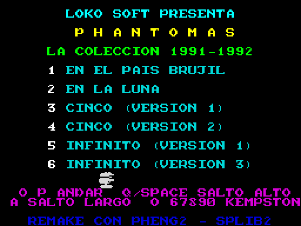
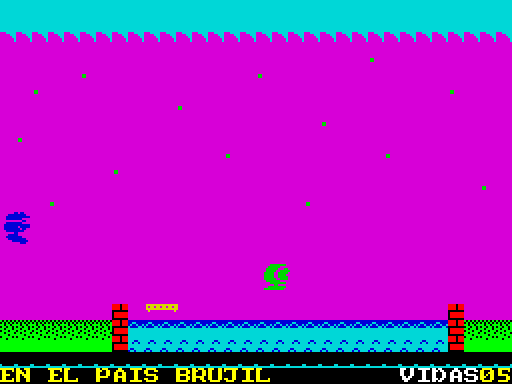
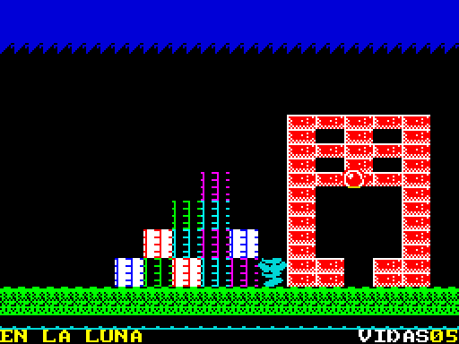
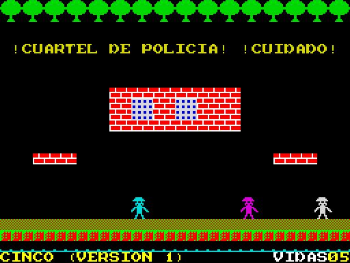
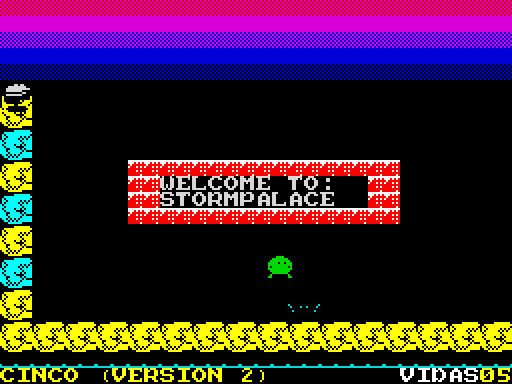
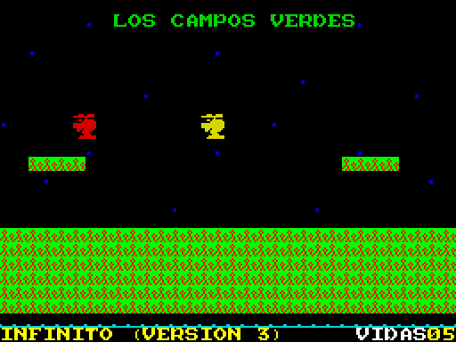

# Phantomas: la colección (LOKO SOFT 1990-1992, remade)

Six Phantomas games written in Sinclair BASIC (some compiled with ERE's
compiler), remade on one engine and loaded in one go:

| key | game | original | rooms |
|---|---|---|---|
| 1 | En el país brujil | 1991, compiled | 16 (3 new, 2 flights instead of the broom shoot-em-up) |
| 2 | En la luna | 1992, compiled | 14 (space flight new) |
| 3 | Cinco (versión 1) | BASIC | 14 |
| 4 | Cinco (versión 2) | compiled | 13 (forest and treasure rooms new) |
| 5 | Infinito (versión 1) | BASIC | 13 |
| 6 | Infinito (versión 3) | compiled | 15 (platforms, flyers added) |

 
 
 

**Controls:** O P walk, Q or SPACE high jump, A long jump. Also Sinclair
(6 7 9 8 0, the originals' keys) and Kempston. In the flying rooms Q and A
go up and down.

## pheng2

A revamp of pheng (the Phantomas Engine, Mojon Twins 2013), whose player
and baddies it keeps: the two jumps (high and long), falling, flip-screen
rooms with four exits, and coming back where you entered the room after
dying.
What changed:

* **Rooms from the room editor** (`gfx/rooms.txt`, compact encoding), on
  one common tileset (`gfx/tiles.png`, 178 tiles: a bold font and graphics
  taken from the six games). BRIGHT = solid, FLASH = deadly, both = a
  platform you can jump onto from below. Besides char, rect and pattern,
  a new object, **zigzag**, fills a rectangle with two tiles taking turns,
  each row staggered (Infinito's brick floors); roomed has it as tool 5. A room's header names its
  backdrop (another room, `bg ...`) and its texts (`gfx/texts.txt`).
* **Games are data** (`gfx/games.txt`): rooms, exits, enemies, start,
  ending text, lives, the player's colour, flying rooms.
* **Generic enemies** shared by all games (`src/enemies.h`): linear (pheng's
  type 1), chaser, random walker, drop, ghost, bouncer, hopper, platform
  (carries you), goal, item, faller, toggle (tiles that switch on and off,
  like Brujas' lightning).
* Masked 16x16 sprites **in colour**: the library's new `SPRCOLOUR` option
  (`../../SPconfig.def`), built as `splib2tc.lib`. A sprite paints its ink
  on blank cells only, so floors keep their colours.
* Collision from a 32x22 map filled while drawing the room, not from the
  screen attributes.
* Hot paths in commented assembly: player (`src/player.h`), enemies,
  drawing (`src/printer.h`, calling splib2's entry points directly). No
  local variables or parameters: globals. Style: mojon-c-style.

The binary ends at about $D900; the space up to $EB80 is free for more
rooms.

## Building

```
../../build.sh variant splib2tc BITMAPBG=0 SPRCOLOUR=1   # once
./build.sh
```

z88dk classic (`../../docs/TOOLCHAIN.md`) and Python 3 (standard library).
The result is `phcomp.tap`: a BASIC loader, the loading screen
(`gfx/loading.scr`, Phantomas en la luna's) and the code.

## Editing

**[EDITING.md](EDITING.md)** explains how rooms are drawn and linked and
how enemies are placed. `tools/edges.py` checks that rooms meet at their
exits and `tools/reach.py` that every exit can be reached; the build runs
both.

| File | What it is |
|---|---|
| `gfx/rooms.txt` | every room and backdrop, room editor format (header at the top). Load `gfx/tiles.png` as the editor's tileset. |
| `gfx/games.txt` | the games: rooms, exits, enemies (format at the top) |
| `gfx/texts.txt` | texts printed in rooms, in numbered sets |
| `gfx/tiles.png` | the tileset, 32 tiles a row, white = ink; 0-63 are the font |
| `gfx/sprites.png`, `gfx/sprites.txt` | 16x16 frames and the names `games.txt` uses |
| `src/phcomp.c` | menu, game loop, input, sound |
| `src/player.h`, `src/enemies.h`, `src/printer.h` | the engine |

`tools/conv.py` (run by `build.sh`) makes `src/assets.h`.

`design/` holds how the first version was made and is not part of the
build: `mkrooms.py` turned the ASCII maps (`*.map`) into `gfx/rooms.txt`
(running it again overwrites the editor's work), `edgefix.py` records
the changes that made the rooms meet, and `mktiles.py` /
`mksprites.py` cut the tileset and sprites from screenshots and UDGs of
the originals (they use paths of the machine they ran on).

## The originals

`orig/` has the six programs as BASIC: the two interpreted ones listed
with SkoolKit, the four compiled ones decompiled with `tools/orig/decomp.py`
and `listing.py` (the CJMC93 decompiler, generalised: the ERE runtime moves
with the loader line, so every address is found from its signature). The
rooms of the remakes follow those listings, then the screenshots of the
originals running.

`tests/` has the scripts used to check every room in an emulator
(`go.sh`, `tour.py`).
