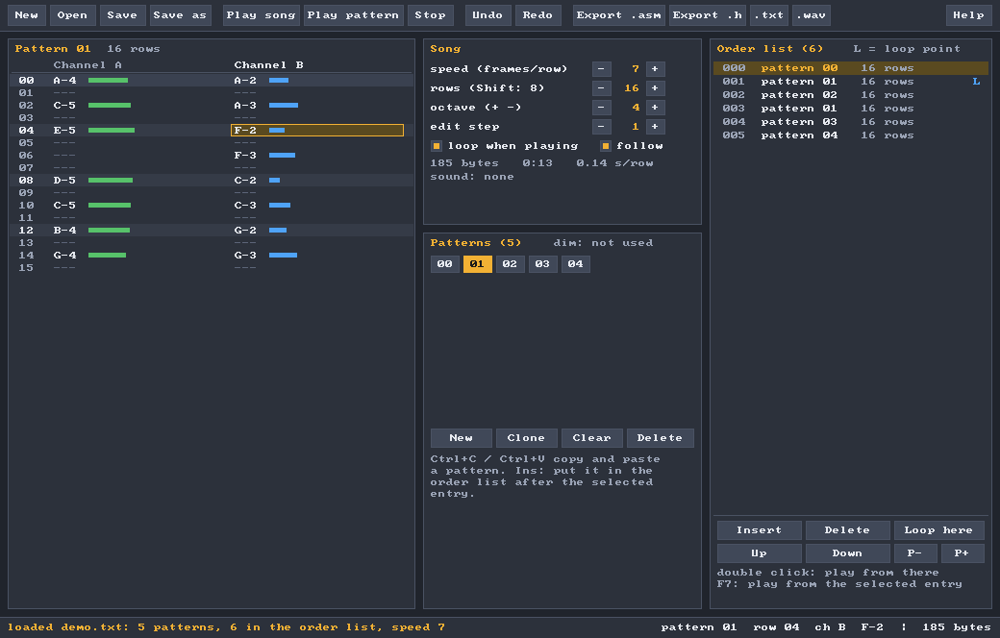

# Beeptune: two-channel beeper music for the ZX Spectrum

Beeptune has two parts:

* **A player** for z88dk programs, [`player/beeptune.h`](player/beeptune.h),
  about 600 bytes. It plays two-channel tunes on the 48K beeper, in the
  style of CJMC3's title music, in three ways:
  1. **once**, until a key is pressed;
  2. **looping**, until a key is pressed;
  3. **one step at a time**, for in-game music, with a length you choose,
     so you decide how much of each frame goes to the music.
* **A tracker** to write the tunes. It looks and works like Suvleir 4
  (`draw.exe`'s successor in this repository): plain C, Windows (GDI) or
  X11, no libraries. Songs are made of **patterns** and an **order list**,
  so patterns can be arranged and repeated. What you hear in the tracker is
  an exact model of the Z80 player.



## The player

Copy `player/beeptune.h` into your project and `#include` it in one C file.
It's a C header with inline asm for sccz80 (z88dk classic), like the other
examples in this repository. Then pass it a song exported by the tracker:

```c
#include "beeptune.h"
#include "song.h"            /* exported with "Export .h": unsigned char song[] */

bt_play (song);              /* once; a key stops it. Returns 1 if a key did   */
bt_loop (song);              /* forever, from the loop point; a key stops it  */

bt_init (song);              /* in-game: get ready...                          */
while (playing) {
    wait_for_the_frame ();
    bt_step ();              /* ...then one step per frame                     */
    move_everything ();
}
```

| Function / variable | What it does |
|---|---|
| `bt_play (song)` | Plays the song once. A key stops it. Returns 1 if a key stopped it, 0 if it reached the end. It waits for the keys to be released first, so the key that started it doesn't stop it. |
| `bt_loop (song)` | Plays the song forever: at the end it jumps back to the song's loop point. A key stops it. |
| `bt_init (song)` | Gets a song ready for `bt_step`. In this mode songs always loop. |
| `bt_step ()` | Sounds the current notes for `bt_steplen` turns, then returns. The song moves on one row every `speed` calls, so calling it once per 50 Hz frame keeps the song's tempo. |
| `bt_steplen` | How long each `bt_step` sounds, in turns of 130 T-states. `BT_FRAME` (538) turns are a whole frame. The default is 134, a quarter of the frame. |
| `bt_border` | Border colour while playing (0-7). |

**How long `bt_step` should be.** It's a trade: the longer each step, the
more the music sounds like notes and the less like clicks, and the less
time the game gets. A game running at 25 fps has two frames per loop:
call `bt_step` twice, or write the song at half speed.

| `bt_steplen` | Time per call | Share of a 50 Hz frame |
|---|---|---|
| 67 (`BT_FRAME/8`) | 2.5 ms | 12% |
| 134 (`BT_FRAME/4`, default) | 5 ms | 25% |
| 269 (`BT_FRAME/2`) | 10 ms | 50% |
| 538 (`BT_FRAME`) | 20 ms | the whole frame |

**Interrupts are off while a tone sounds** (they would make the pitch
wobble). They are turned back on only if they were on before. An interrupt
that falls inside a tone is lost, so a game that counts frames in its ISR
sees fewer of them while music plays in `bt_step` mode.

**Registers:** AF, BC, DE, HL and the alternate BC', DE', HL' (`EXX`). IX
and IY are left alone.

### How it sounds

Each channel is a square wave from a 16-bit phase accumulator: add the
note's step, and the top bit is the wave. In each turn of the loop
(130 T-states, 26.9 kHz), the speaker shows channel A for about half the
turn, then channel B. That time-division mixing makes both heard at once,
the usual trick of beeper engines since the 80s. Steps are
`65536 × f × 130 / 3500000`, so notes are accurate to well under 1%.

There are no volumes, envelopes or drums: just two notes at a time, held
or silenced.

### The song format

The format is binary, about 2 bytes per row. Offsets are from the start of
the song, so it works at any address.

| Offset | Contents |
|---|---|
| +0 | speed: frames (1/50 s) per row, 1-255 |
| +1 | L: length of the order list, 1-255 |
| +2 | loop point: the order list entry to go back to, 0..L-1 |
| +3 | P: number of patterns, 1-64 |
| +4 | the order list: L pattern numbers |
| +4+L | P words (little endian): the offset of each pattern |
| patterns | the number of rows (1-128), then 2 bytes per row: channel A, channel B |

Each note byte is:

* 0: keep playing (`---`);
* 1: silence (`===`);
* 2-85: the notes from C-1 to B-7 (`2 + 12 × (octave − 1) + semitone`).

## The tracker

```
beeptune [song.bts | song.txt]
```

| Area | What's there |
|---|---|
| **Pattern** (left) | The two channels of the pattern being edited, one row per line. Rows 0, 4, 8... are lighter, so the beat is visible. Each note has a bar showing how high it is, so the shape of the tune shows. |
| **Song** | Speed (frames per row), the pattern's number of rows, the octave of the keyboard, the edit step (rows the cursor moves after a note), loop and follow for playback. Also the song's size in bytes and its length. |
| **Patterns** | Every pattern; dim ones aren't in the order list yet. *New*, *Clone*, *Clear*, *Delete* (only patterns no longer used). |
| **Order list** (right) | The order the patterns play in. A pattern can appear many times. *Insert* adds the current pattern after the selected entry. *Up*/*Down* move an entry, *P-*/*P+* change its pattern, *Loop here* sets the loop point (marked L). Double-click an entry to play from it. |

**Keys**:

| Key | Action |
|---|---|
| `Z S X D C V G B H N J M` | notes in the octave shown in the panel |
| `Q 2 W 3 E R 5 T 6 Y 7 U` | one octave up |
| `I 9 O 0 P` | two octaves up |
| `1` | silence (`===`) |
| `Del` / `Backspace` | keep playing (`---`) |
| `Ctrl+↑` / `Ctrl+↓` | transpose a semitone (with Shift: an octave) |
| `+` / `-` | keyboard octave |
| arrows, `Tab`, `PgUp`/`PgDn`, `Home`/`End`, the mouse, the wheel | move around |
| `Ctrl+←` / `Ctrl+→` | previous / next pattern |
| `Ctrl+C` / `Ctrl+V` | copy and paste a whole pattern |
| `Ins` | add the current pattern to the order list |
| `Ctrl+Del` | remove the selected order list entry |
| `F5` | play the song |
| `F6`, or `Space` | play the pattern (`Space` also stops) |
| `F7` | play the song from the selected entry |
| `F8` / `Esc` | stop |
| `Ctrl+Z` / `Ctrl+Y` | undo / redo |
| `Ctrl+N`, `Ctrl+O`, `Ctrl+S`, `Ctrl+Shift+S` | new, open, save, save as |
| `F1` | help |

Typing a note plays it.

**Files**:

* **`.bts`** is the player's own format, so it can be `incbin`'d as it is.
* **Export .asm** writes z80asm `defb` lines.
* **Export .h** writes a C array.
* **.txt** is a readable text version: one row per line, like `C-4 A-2`.
  It's good for version control and for writing songs by hand. The tracker
  opens it too. See [`demo/demo.txt`](demo/demo.txt).
* **.wav** is the song as the Spectrum plays it.

**Sound**:

* **Windows** uses waveOut, which is part of Windows.
* **Linux and others** pipe the sound to `aplay`, `pw-cat` or `paplay`,
  whichever is installed (the Song panel shows which). Without any of
  them, the tracker works without sound, and you can still export a WAV.

**Command line**, for build scripts:

```
beeptune -wav  in out.wav [-loop SECONDS]
beeptune -asm  in out.asm [label]
beeptune -c    in out.h   [label]
beeptune -bts  in out.bts
beeptune -txt  in out.txt
beeptune -info in
```

`in` may be a `.bts` or a `.txt` song.

### Building

Prebuilt: `bin/beeptune.exe` (Windows 10/11, 64-bit) and
`bin/beeptune-linux-x86_64` (needs X11).

```
make                 # Linux / BSD / macOS (needs X11 headers: libx11-dev, XQuartz...)
build.bat            # Windows with MinGW-w64 gcc (w64devkit, MSYS2...)
make windows         # cross-compile from Linux (x86_64-w64-mingw32-gcc / llvm-mingw)
make headless        # test build driven by a script, no window, silent
tests/run_tests.sh   # file round trips, render timing, a scripted editing session
```

The window code is Suvleir 4's: `src/plat_*.c`, `src/ui.c` and the
public-domain `third_party/font8x8_basic.h`.

## The demo

[`demo/`](demo) builds `demo.tap` (`demo/build.sh`). Its menu has the
three modes:

* **1:** `bt_play`, the song once.
* **2:** `bt_loop`, the song forever.
* **3:** `bt_step`. A square bounces round the screen at 50 fps while the
  music plays. **O** and **P** change `bt_steplen`, and the screen shows
  what share of each frame it takes.

The song is [`demo/demo.txt`](demo/demo.txt), an original tune.

## How it was checked

* **Same sound as the Spectrum:** the Z80 player was run in an emulator
  (SkoolKit) and its speaker output recorded. Its pitches match the
  tracker's WAV, and its length matches within 10 ms over 13.5 s. The
  model includes the player's 344 T-states of work between frames.
* **`bt_step`:** at the default length, the speaker is busy 22% of the
  time, against 25% expected.
