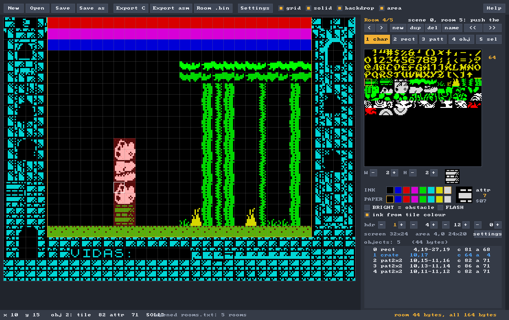
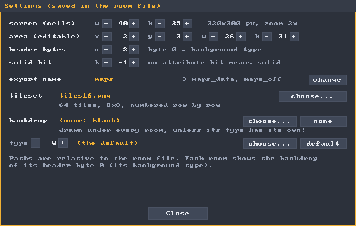
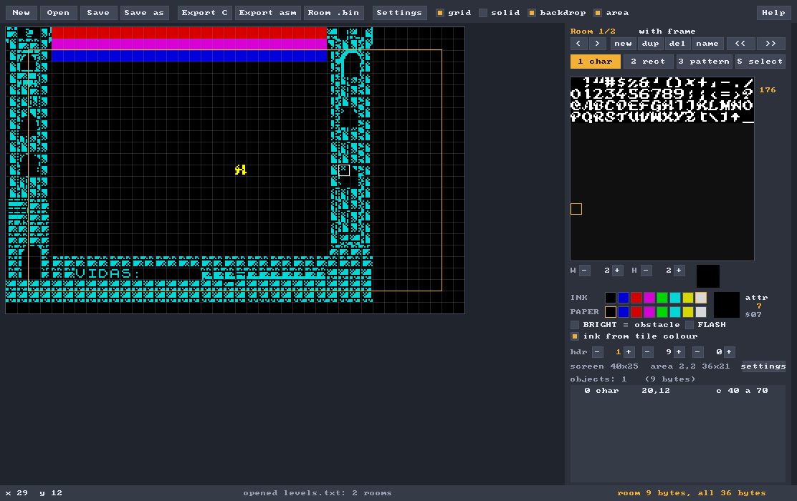

# roomed — room editor for 8×8-cell tile engines

A small native editor for rooms made of objects (single characters,
rectangles, patterned rectangles of 8×8 tiles, and fixed-size objects you
declare, like CJMC's pushable crate). Written for CJMC, usable
for other games: the screen and area size, the tileset, the backdrops, the
header size, which attribute bit means "solid" and the export names are
**settings saved in the room file**, not built in. It shows the screen
(zoomed to fit) with the backdrop behind it, the tileset beside it, and you
place the objects with the mouse.

In CJMC, rooms are kept in `gfx/rooms.txt`, which the game's build compiles
(`tools/conv.py`).



* **What you see is what the game draws.** Objects are drawn in list
  order with the same rules as CJMC's `room_draw()` (`src/printer.h`).
  This was checked pixel for pixel, and cell for cell on the collision
  map, against the game running the same rooms.
* **The tileset follows the game.** CJMC's build writes the whole 256-tile
  set to `gfx/tileset.png`, and the editor reloads it whenever it changes,
  so new tiles appear while the editor is open.
* **Portable, no dependencies.** Plain C99, built on Suvleir 4's platform
  layer (`splb2-bitmapbg/tools/suvleir4`). Windows needs nothing extra
  (GDI, one `.exe`); Linux, BSD and macOS (XQuartz) need Xlib. The only
  third-party code is two public-domain headers (`stb_image.h`,
  `font8x8_basic.h`).

## Getting it

Prebuilt: `bin/roomed.exe` (Windows 10/11, 64-bit) and
`bin/roomed-linux-x86_64`.

Building:

```
build.bat            Windows, MinGW-w64 gcc (w64devkit, MSYS2...)
./build.sh           Linux / BSD / macOS (needs libx11-dev / XQuartz)
make windows         cross-compile from Linux (mingw-w64 / llvm-mingw)
tests/run_tests.bat  (or .sh) export check + scripted UI session
```

## Using it

From the game's folder, `rooms.bat` (or `./rooms.sh`) refreshes
`gfx/tileset.png` and opens `gfx/rooms.txt`. Or:

```
roomed [rooms.txt]
roomed -render rooms.txt N out.bmp     draw room N
roomed -export rooms.txt rooms.h       C arrays: NAME_data, NAME_off, NUM_NAME
roomed -asm rooms.txt rooms.asm        the same in assembler (defb / defw)
roomed -bin rooms.txt N room.bin       room N in binary
roomed -info rooms.txt                 rooms, objects, bytes
```

### Window

* **Canvas**: the screen (32×24 cells in CJMC, at 3×; bigger screens get a
  smaller zoom). Behind the objects is the **backdrop** for the room's
  background type. The orange frame is the **area** (CJMC: x 4, y 0, 24×20
  cells, the play area). Objects can only be created inside it. The status bar shows the cell under the mouse, which
  object is on top there, its tile and attribute, and whether the cell is
  solid.
* **Tileset**: up to 256 tiles, 16 per row, each in its own colour. Click
  one to choose it. With *ink from tile colour* on, choosing a tile also sets
  the INK to the tile's colour. Tiles 0-63 are the font (tile = ASCII − 32).
* **W / H**: the figure size for patterns, with a preview of the figure.
* **INK / PAPER / BRIGHT / FLASH**: the attribute. In CJMC **BRIGHT means
  obstacle**: the game makes those cells solid (the *solid bit* setting).
* **hdr**: the room's header bytes (as many as the settings say; byte 0 is
  the background type, which picks the backdrop).
* **settings**: see below.
* **Object list**: every object of the room, in drawing order. Click to
  select; *up/down* reorder, *del* deletes, *apply tile+attr* gives the
  selected object the current tile, attribute (and W, H).

### Tools

| Tool | Key | How |
|---|---|---|
| **char** | `1` | Click: one cell. Drag: paint, one object per cell. |
| **rect** | `2` | Drag a rectangle: filled with the tile. |
| **pattern** | `3` | Drag a rectangle: filled with a W×H figure made of tiles CODE … CODE+W·H−1, row by row (the selected run is outlined in the tileset). |
| **zigzag** | `5` | Drag a rectangle: filled with two tiles taking turns, CODE and CODE+1, each row starting one cell further on (CODE CODE+1 CODE…, then CODE+1 CODE CODE+1…). Staggered bricks made of a left half and a right half, checkerboards. Both tiles are outlined in the tileset. |
| **object** | `4` | Click: places the custom object chosen with `<` `>` in the panel (its size is fixed by its declaration), with the current tile and attribute, or, for a *number* object, the values *a* and *b* set in the panel. |
| **select** | `S` | Click an object (the one on top), drag it to move it, drag its corner (small square) to resize it. Arrows move it a cell. |

**Right click** anywhere picks the tile, attribute (and W, H for patterns)
from that cell, whatever the tool.

Keys: `PgUp`/`PgDn` previous/next room, `Del` delete the selection,
`Ctrl+↑/↓` move it earlier/later in the list, `A` apply the current
tile/attribute, `G` grid, `K` show solid cells, `B` show the frame, `R`
reload the tileset, `Ctrl+Z`/`Ctrl+Y` undo/redo, `Ctrl+S` save,
`Ctrl+Shift+S` save as, `Ctrl+O` open, `Ctrl+N` new, `Ctrl+E` export C,
`F1` help.

Rooms: `<` `>` move between rooms, *new* adds an empty room after the
current one, *dup* copies it, *del* deletes it, *name* renames it, `<<` `>>`
move it earlier/later (room numbers are the order in the file).

## Settings



*Settings* (toolbar or panel) holds everything that ties a room file to a
game. It's all saved in the room file:

| Setting | File | |
|---|---|---|
| screen | `screen W H` | in cells, up to 96×72. CJMC: 32 24 |
| area | `area X Y W H` | where objects can go. CJMC: 4 0 24 20 |
| header bytes | `header_bytes N` | 0-8 per room (the ones you edit). CJMC: 3 |
| encoding | `encoding plain` / `compact` | how the bytes are written (below). CJMC: compact |
| bg params | `bg_params TYPE N` | compact: a room of that background type stores the type byte + N parameter bytes (types without it store all `header_bytes`). CJMC: `0 0`, `1 2` |
| solid bit | `solid_bit B` | the attribute bit that makes a cell solid, −1 = none. CJMC: 6 (BRIGHT) |
| export name | `export NAME` | `NAME_data`, `NAME_off`, `NUM_NAME` in the exports. CJMC: rooms |
| tileset | `tileset FILE` | any PNG of 8×8 tiles, numbered row by row (its width sets the tiles per row), up to 256 |
| backdrop | `background FILE` | picture under every room (cropped / padded to the screen; colours snapped to the Spectrum's) |
| backdrop per type | `background N FILE` | picture for rooms whose header byte 0 is N (0-15). `%1` … `%7` in FILE are replaced by that room's header bytes, so a procedural background can have one picture per room (CJMC: `background 1 preview/forest_%1_%2.png`). If that file doesn't exist (yet), the default backdrop is shown. Backdrops are reloaded when the files change |
| custom objects | `object TYPE NAME W H [solid] [number]` | an extra object type (3-254; 3-63 with the compact encoding): written `NAME X Y CODE ATTR` in the file, `X Y TYPE CODE ATTR` in binary, drawn as a W×H figure of the tiles CODE, CODE+1… *solid* shows it as solid whatever the attribute. *number*: CODE and ATTR are two values, not a tile and a colour (a baddie's type and flags, say); it's drawn as a magenta W×H box with the two numbers, and the panel has two spinners (*a*, *b*) for them. CJMC: `object 3 crate 2 2 solid`, `object 4 baddie 3 2 number` |

### Using it for another game

Make a new room file (*New*), open *Settings*, set the screen, area,
header size, solid bit and export name, choose the tileset and the
backdrops, and save. Then either export (`-export`, `-asm`, `-bin`, also
from the toolbar) or read the text file from your own build script, as
CJMC's `tools/conv.py` does.



*A 40×25 screen with a 16-per-row tileset, 2 header bytes and a backdrop
only for background type 1.*

### What is still fixed

* **Object shapes**: char, rect, pattern and zigzag, plus custom objects, which
  are always a fixed-size block with CODE and ATTR as parameters. Objects
  with other parameters (an enemy's speed, a door's target room) would
  need a way to declare their bytes.
* **8×8 cells and Spectrum attributes** (INK, PAPER, BRIGHT, FLASH and the
  Spectrum palette). Fine for any Spectrum game; another machine would
  need its own colour model.
* **One room per screen.** Rooms bigger than the screen (scrolling maps)
  aren't supported.

## Room file format

```
screen 32 24                 # settings (see above)
area 4 0 24 20
header_bytes 3
solid_bit 6
encoding compact
bg_params 0 0                # background type 0: no parameters
bg_params 1 2                # type 1: two
export rooms
tileset tileset.png          # paths relative to this file
background templ.png         # backdrop for every background type
background 1 other_%1.png   # ...except type 1 (%1 = header byte 1)
object 3 crate 2 2 solid     # custom object types

room first room              # a room, with an optional name
header 1 4 12                # header_bytes values
char X Y CODE ATTR
rect X Y CODE ATTR X2 Y2
pattern X Y CODE ATTR X2 Y2 W H
zigzag X Y CODE ATTR X2 Y2   # CODE, CODE+1 taking turns, rows staggered
crate X Y CODE ATTR          # a custom object, by its name
end
```

It's plain text so it can be diffed and merged.

Binary (exports; CJMC's `tools/conv.py` writes the same into `src/assets.h`).
Room *n* starts at `NAME_data + NAME_off [n]`; every room ends with `0xFF`.

| | plain | compact |
|---|---|---|
| header | the `header_bytes` bytes | the type byte + `bg_params [type]` bytes |
| char | `X Y 0 CODE ATTR` | the same |
| rect | `X Y 1 CODE ATTR X2 Y2` | the same |
| pattern | `X Y 2 CODE ATTR X2 Y2 W H` | one copy: `X Y 0x80\|(W-1)<<3\|(H-1) CODE ATTR`; repeated: `X Y 0x40\|(W-1)<<3\|(H-1) CODE ATTR X2 Y2` (W, H 1-8) |
| zigzag | `X Y 254 CODE ATTR X2 Y2` | `X Y 2 CODE ATTR X2 Y2` |
| custom | `X Y TYPE CODE ATTR` | the same (TYPE 3-63; 3-253 plain, 254 is the zigzag) |

The tile of a zigzag at a cell is CODE + ((column − X + row − Y) AND 1): the
cell at the zigzag's top-left corner is always CODE.

With the compact encoding the exports refuse rooms it can't express (a
pattern bigger than 8×8, a custom type over 63) and say which room and
object; the W/H spinners stop at 8.
