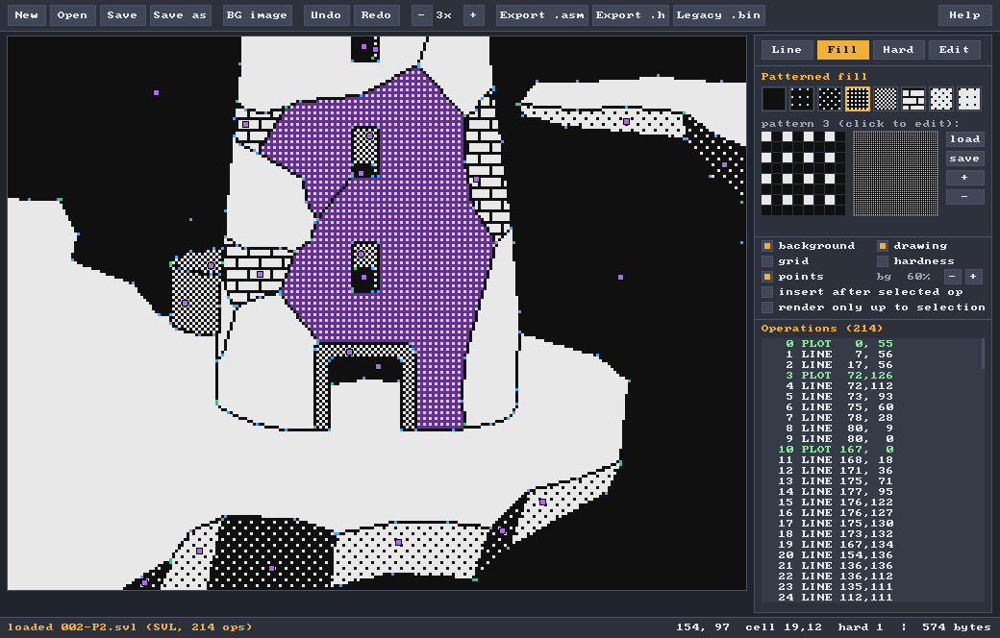

# Suvleir 4 — vector screen editor

Suvleir 4 replaces `draw.exe` (Suvleir 3). You load a background picture,
trace over it with lines, plots and patterned fills, paint the 32×24 hardness
(collision) map, and save a compact **SVL** file. The engine draws that file
directly with `sp_VecDraw()` from splib2-bitmapbg.



* **What you see is what the Spectrum draws.** The editor uses the engine's
  exact line algorithm and splib2's `SPPFill` rules, with the same pattern
  table. Hovering with the fill tool previews the real result, leaks
  included. The Lhikoj screens were checked pixel for pixel against the Z80
  output in an emulator.
* **Portable, few dependencies.** It is plain C99. Windows needs nothing
  extra (GDI + common dialogs; one `.exe`). Linux, BSD and macOS (XQuartz)
  need Xlib. The only third-party code is two public-domain headers
  (`stb_image.h`, `font8x8_basic.h`), included in `third_party/`.
* **Backgrounds:** PNG, JPG, BMP, GIF, TGA, PSD, PNM, **PCX** (the old
  `fondo.pcx`) and ZX **`.scr`** screens. They are scaled to 256×192 and shown
  under the drawing at an adjustable opacity.
* **Legacy files:** old `draw.exe` `.bin` files open directly and are saved
  as `.svl`. You can still export the old format if you need it.
* **Exports:** `.svl` (binary, for `incbin`), z80asm source (`defb`), a C
  array, and legacy Suvleir 3 `.bin`.
* **Command line** for build scripts: convert, render to BMP, info, export.

## Getting it

Prebuilt: `bin/suvleir4.exe` (Windows 10/11, 64-bit) and
`bin/suvleir4-linux-x86_64`.

Building:

```
make                 # Linux / BSD / macOS (needs X11 headers: libx11-dev, XQuartz...)
build.bat            # Windows with MinGW-w64 gcc (w64devkit, MSYS2...)
make windows         # cross-compile from Linux (x86_64-w64-mingw32-gcc / llvm-mingw)
make headless        # test build driven by a script, no window
tests/run_tests.sh   # round trips, legacy import, scripted UI session
```

## Using it

```
suvleir4 [screen.svl | old.bin] [-bg picture.png] [-patterns table.bin]
```

The window has a toolbar (files, background, undo, zoom, exports), the canvas
(256×192 at 3× by default), a side panel (tools, layers, operation list) and a
status bar. The status bar shows the cursor in pixels and cells, the hardness
under the cursor, and the **size of the SVL file in bytes**, so you can keep
an eye on the memory budget.

### Tools

| Tool | Key | How |
|---|---|---|
| **Line** | `L` | Click to start a polyline. The start is a MOVE by default, or a PLOT. Each further click adds a LINE. Right click, Enter or Esc ends it. Clicks **snap to existing points** (green box), so closing a shape is easy; hold **Alt** to stop snapping. **Shift** constrains to 0/45/90°. A red preview shows the exact pixels the engine will draw. |
| **Fill** | `F` | `1`–`8` or click a swatch to pick a pattern. Hovering shows the exact fill result in purple. Click to add the FILL. If the seed is on an ink pixel the fill is refused, because the engine would do nothing. The 8×8 editor below the swatches changes the pattern table; *load/save* it so it matches your engine's. |
| **Hardness** | `H` | `0`–`3` picks the value. Left-drag paints, right-drag paints 0, and Shift+drag (or *rect* mode) fills a rectangle. *ink → v* gives the value to every cell that is at least half ink. *all = v* and *clear* fill the whole map. |
| **Edit** | `E` | Click near a point to select its operation, then drag to move it, use the arrows to nudge it 1 px, or press Del to delete it. The panel can change a fill's pattern, switch PLOT/MOVE, or move the operation *earlier/later* in the list. PgUp/PgDn step through operations. |

Operations run in order, which matters for fills. The **operation list**
shows them all; click one to select it. Two options help when editing in the
middle of the list:

* **insert after selected op**: new operations go after the selection instead
  of at the end;
* **render only up to selection**: shows the screen as the engine has drawn
  it at that step.

### Layers and view

`B` background, `D` drawing, `G` grid, `K` hardness overlay, `P` point
markers. `bg %` sets how strongly the background shows through the paper.
Zoom with `+`/`-` or Ctrl+wheel. Pan with the wheel (Shift+wheel for
horizontal), the middle button, or the arrow keys.

### Files

Ctrl+N, Ctrl+O, Ctrl+S and Ctrl+Shift+S do new/open/save/save as.
Ctrl+Z / Ctrl+Y undo and redo (100 levels). Ctrl+B loads a background. F1 shows
help. On Windows you get the native file dialogs and can **drop** images or
screens on the window. On X11 there is a built-in file browser: type a name or
double-click; when a name is suggested, typing replaces it. You are asked
before unsaved changes are lost.

### Command line

```
suvleir4 -convert old.bin new.svl [-keep-trailing-plot]   legacy -> SVL
suvleir4 -legacy screen.svl old.bin                       SVL -> legacy
suvleir4 -render screen.svl out.bmp [-bg pic] [-hard] [-patterns t.bin]
suvleir4 -info screen.svl
suvleir4 -asm screen.svl screen.asm [label]               defb listing
suvleir4 -c screen.svl screen.h [label]                   C array
```

All commands accept SVL or legacy input.

## In the engine

```c
#include <spritepack.h>          /* splib2-bitmapbg */

extern unsigned char screen1[];  /* the .svl, e.g. via the -asm export */

sp_VecConfig(0, (void *) (SP_BGSHADOW + 6144), 1000);   /* once: built-in patterns,
                                                           fill queue in the shadow */
cls();
sp_VecDraw(screen1, hardness, 1);   /* draw on $4000, 768 bytes of hardness */
sp_BgCapture();                     /* make it splib2's background         */
```

See [`docs/FORMAT.md`](docs/FORMAT.md) for the byte format and
[`../../docs/VECTOR.md`](../../docs/VECTOR.md) for the engine side. The
Lhikoj example in `example/lhikoj` uses all of this.

## Source layout

```
src/vec.c        model, SVL + legacy formats, engine-exact renderer, exports
src/img.c        background loading (stb_image, PCX, SCR) and BMP output
src/app.c        the editor
src/ui.c         tiny immediate-mode UI (8x8 font, buttons, checkboxes)
src/plat_*.c     platform layers: win32 (GDI), x11, headless (scripted tests)
src/main.c       command line
third_party/     stb_image.h (public domain / MIT), font8x8_basic.h (public domain)
tests/           run_tests.sh + ui_smoke.txt (headless UI script)
```

To port it to another platform, write one `plat_*.c` (window, events,
present).

## Notes

* The Windows build was cross-compiled with llvm-mingw. It links only to
  system DLLs plus the Universal C Runtime that ships with Windows 10/11. On
  Windows 7/8, install the UCRT update or build it yourself with
  `build.bat`.
* The window is fixed at 1040×664.
